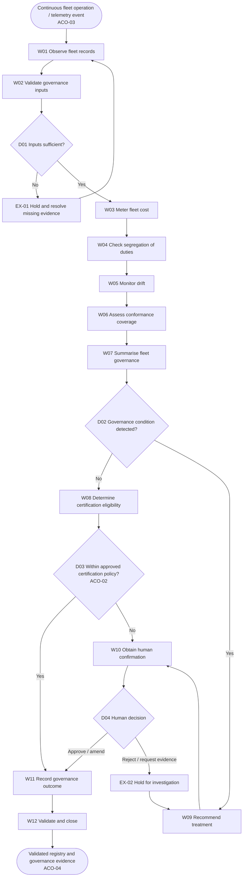
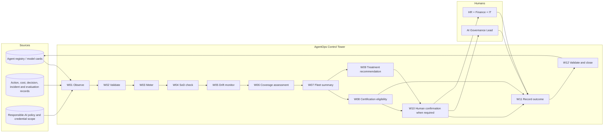

# HR-GOV-001: AgentOps Control Tower

**Stage 3 – Decompose Deliverable**

> **Prepared for:** Stage 3 SME review and sign-off  
> **Document version:** Draft v0.1  
> **Date:** 18 September 2026  
> **Prepared by:** Agent Factory delivery team  
> **Classification:** KPMG Confidential

# Document Control

| Control Item | Details | Evidence |
|---|---|---|
| Document title | AgentOps Control Tower – Stage 3 Decompose Deliverable | User instruction |
| Version | Draft v0.1 | Document control |
| Status | Draft – SME validation pending | No SME confirmation was supplied [SRC-01, section 9.12] |
| Business agent ID | HR-GOV-001 | [SRC-04, section 6.7] |
| Prepared for | Stage 3 SME review and sign-off | [SRC-03, template Document Control] |
| Date | 18 September 2026 | Session context |
| Approval required from | Business SME, capability owner and Stage 3 approver; names not supplied (ACO-06) | [SRC-01, section 9.12] |
| Review purpose | Confirm capability, workflow, decisions, exceptions, handovers and human-intervention model | [SRC-02, Stage 3 activities 6–7] |

## Version History

| Version | Date | Author | Summary of Change | Status | Evidence |
|---|---|---|---|---|---|
| 0.1 | 18 September 2026 | Agent Factory delivery team | Initial evidence-based Stage 3 decomposition | Draft | This document |

## Review and Approval

| Role | Name | Review / Approval | Date | Evidence / Reference |
|---|---|---|---|---|
| Business SME | TBC-01 (ACO-06) | Pending | Not supplied | No evidence supplied |
| Capability owner | TBC-02 (ACO-01) | Pending | Not supplied | Owner terminology conflict [SRC-04, sections 5.7 and 6.7] |
| Stage 3 approver | TBC-03 (ACO-06) | Pending | Not supplied | No evidence supplied |

# Table of Contents

1. [Executive Summary](#1-executive-summary)
2. [Stage 3 Activities and Outputs](#2-stage-3-activities-and-outputs)
3. [Step 1 – Review and Understand the Capability](#3-step-1--review-and-understand-the-capability)
4. [Step 2 – Create the Overall AI Framework](#4-step-2--create-the-overall-ai-framework)
5. [Step 3 – Map the End-to-End Workflow](#5-step-3--map-the-end-to-end-workflow)
6. [Step 4 – Decompose into Workflow Steps](#6-step-4--decompose-into-workflow-steps)
7. [Step 5 – Define Handovers and Interactions](#7-step-5--define-handovers-and-interactions)
8. [Decisions, Exceptions and Human Intervention Points](#8-decisions-exceptions-and-human-intervention-points)
9. [Steps 6 and 7 – SME Validation and Confirmation](#9-steps-6-and-7--sme-validation-and-confirmation)
10. [Completion and Quality Checklist](#10-completion-and-quality-checklist)
11. [Appendix A – Glossary and Acronyms](#appendix-a--glossary-and-acronyms)
12. [Appendix B – Source and Evidence Register](#appendix-b--source-and-evidence-register)
13. [Appendix C – Stage 3 to Stage 4 Handover](#appendix-c--stage-3-to-stage-4-handover)

# 1. Executive Summary

The AgentOps Control Tower supports **Continuous Agent Workforce Management** by governing the digital workforce across HR, Finance and O2C. Its stated purpose is to onboard, credential, meter, monitor, develop, safeguard and retire AI agents with a workforce-style control plane. [SRC-04, section 5.7, Purpose]

The supported operating sequence is **Observe → Meter → Monitor → Recommend → human confirmation → Certify/Retire**. The capability reads the agent registry, access and credential scope, incident and escalation log, Responsible-AI policy and model cards, and writes a FleetGovernance outcome covering cost, drift, segregation of duties (SoD) and conformance coverage. [SRC-04, section 5.7, Behaviours; Inputs; Outputs]

The overall agent record states L2 Augmented operation, while the capability description permits L3 auto-certification within policy. Onboarding, autonomy or scope increases, kill-switch operation and retirement remain human-confirmed. This apparent autonomy distinction requires SME confirmation under ACO-02 and must not be interpreted as authority for consequential autonomous action. [SRC-04, sections 5.7 and 6.7]

The evidence supports a coherent review draft, but not Stage 3 completion. Owner terminology conflicts, entry and completion criteria need confirmation, operational interfaces and control thresholds are incomplete, and no SME review or approval evidence was supplied. [ACO-01–ACO-09]

# 2. Stage 3 Activities and Outputs

| Step | Activity | Capability-specific output/status | Evidence |
|---|---|---|---|
| 1 | Review and understand the capability | Capability, boundaries, measures and nine controlled gaps documented | [SRC-02, Stage 3 activity 1] |
| 2 | Create Overall AI Framework | Logical framework in section 4 | [SRC-02, Stage 3 activity 2] |
| 3 | Map end-to-end workflow | Trigger-to-end-state map in section 5 | [SRC-02, Stage 3 activity 3] |
| 4 | Decompose into workflow steps | W01–W12 catalogue in section 6 and CSV | [SRC-02, Stage 3 activity 4] |
| 5 | Define handovers and interactions | H01–H09 and DEP-01–DEP-07 in section 7 and CSV | [SRC-02, Stage 3 activity 5] |
| 6 | Validate with SME | Walkthrough checklist prepared; validation pending | [SRC-02, Stage 3 activity 6] |
| 7 | Obtain SME confirmation | Confirmation pending; no approval claimed | [SRC-02, Stage 3 activity 7] |

## 2.1 Inputs from Stage 2

The user explicitly designated `Reference/HR_Capability_and_Full_Agent_Catalogue_v1.md` as the approved Stage 2 output. It provides the capability purpose, outcome, behaviours, inputs, outputs, rules, controls, risks, measures and agent record. [SRC-04, sections 1, 3, 4 and 5.7]

## 2.2 Outputs of Stage 3

This document provides the Overall AI Framework, Mermaid process maps, workflow decomposition, handovers, dependencies, decisions, exceptions, human interventions, validation materials and Stage 4 handover required by the methodology. Supporting structured catalogues are supplied as CSV files. [SRC-01, section 6; SRC-02, Outputs of Stage 3]

# 3. Step 1 – Review and Understand the Capability

## 3.1 Capability Summary

| Area | Definition | Evidence |
|---|---|---|
| Business capability | Continuous Agent Workforce Management | [SRC-04, Part 1, Govern to Evolve row] |
| Business outcome | Govern the digital workforce through a registry, zero SoD breaches and AI Act/ISO 42001 conformance | [SRC-04, Part 1, Govern to Evolve row] |
| Business agent | AgentOps Control Tower (HR-GOV-001) | [SRC-04, section 6.7] |
| Purpose | Manage agents across HR, Finance and O2C through onboarding, credentialing, metering, monitoring, development, safeguarding and retirement | [SRC-04, section 5.7, Purpose] |
| Owner persona | AI Governance / AgentOps Lead; conflicting engineering record says HR Governance Lead (ACO-01) | [SRC-04, sections 5.7 and 6.7] |
| Users | AI Governance Lead operates the control tower; HR, Finance and IT jointly authorise the digital establishment | [SRC-04, section 5.7, Human-in-the-loop boundary] |
| Autonomy | L2 Augmented overall; in-policy auto-certification described as L3 (ACO-02) | [SRC-04, sections 5.7 and 6.7] |
| Trigger | Continuous fleet operation and incoming action, cost and decision logs; precise event/cadence requires confirmation (ACO-03) | [SRC-04, sections 4.1 and 6.7, Generic agent script] |
| End state | Registry committed and validated, governance evidence recorded, and a case closed following certification or human-confirmed action; confirm formal closure criteria (ACO-04) | [SRC-04, section 6.7, Generic agent script] |

## 3.2 Capability Boundary

| Boundary Type | Definition | Evidence |
|---|---|---|
| In scope | Fleet registration/governance, cost and consumption metering, drift monitoring, SoD checks, conformance coverage, recommendations, in-policy certification, escalation, registry update, validation and evidence | [SRC-04, sections 3, 5.7 and 6.7] |
| Cross-domain scope | Agent fleet across HR, Finance and O2C | [SRC-04, section 5.7, Purpose] |
| Human-reserved actions | Onboarding, scope or autonomy increase, kill-switch operation and retirement | [SRC-04, section 5.7, Human-in-the-loop boundary; Governance controls] |
| Mandatory guardrails | Human confirmation for consequential lifecycle changes; fleet-wide SoD; full action and decision logging; human-operated kill-switch | [SRC-04, section 5.7, Governance and compliance controls] |
| Principal dependencies | Agent registry/model cards, access and credential scope, incident/escalation log, Responsible-AI policy, evaluation telemetry, and action/cost/decision logs | [SRC-04, sections 4.1, 5.7 and 6.7] |
| Out of scope | Detailed technical architecture and Stage 4 component classification are excluded by methodology; further business exclusions require SME confirmation (ACO-05) | [SRC-01, section 14] |

## 3.3 Success Measures

| ID | Measure | Baseline | Target | Method / Evidence | Owner | Evidence |
|---|---|---|---|---|---|---|
| SM-01 | Fleet registered and continuously monitored | Not supplied | 100% | Registered and monitored agents / total fleet | TBC-04 (ACO-07) | [SRC-04, section 5.7, Evaluation criteria] |
| SM-02 | SoD breaches | Not supplied | 0 | Deterministic `sod_check` over agent activity/approval records | TBC-04 (ACO-07) | [SRC-04, sections 3 and 5.7, Evaluation criteria] |
| SM-03 | EU AI Act / ISO 42001 conformance coverage | Not supplied | ≥90% | Conformant agents / total fleet | TBC-04 (ACO-07) | [SRC-04, section 5.7, Deterministic calculation requirements; Evaluation criteria] |
| SM-04 | Mean time to detect drift | Not supplied | TBC-05 (ACO-07) | Difference between supported drift onset/observation and detection timestamps; method requires SME confirmation | TBC-04 (ACO-07) | [SRC-04, section 5.7, Evaluation criteria] |

## 3.4 Assumptions, Constraints and Open Questions

No assumption is used as fact. All unresolved points are controlled below.

| ID | Type | Description | Impact | Owner | Resolution action | Status / Due Date | Affected sections | Evidence |
|---|---|---|---|---|---|---|---|---|
| ACO-01 | Open question | Which owner label is authoritative: AI Governance / AgentOps Lead or HR Governance Lead? | Accountability and approval routing | Stage 3 approver | Confirm canonical business-owner persona and role nomenclature | Open / date not supplied | 3, 4, 7–9 | [SRC-04, sections 5.7 and 6.7] |
| ACO-02 | Open question | Confirm boundary between L2 overall autonomy and L3 in-policy auto-certification. | Control and approval boundary | AI Governance Lead | Approve an autonomy statement and certification policy boundary | Open / date not supplied | 1, 3–8 | [SRC-04, sections 5.7 and 6.7] |
| ACO-03 | Open question | Confirm initiating events and operating cadence for continuous monitoring. | Entry criteria and handover timing | AI Governance Lead | Define supported triggers and cadence | Open / date not supplied | 3, 5, 7 | [SRC-04, sections 4.1 and 6.7] |
| ACO-04 | Open question | Confirm formal end-state and closure criteria for certify, restrict, tune and retire paths. | Workflow completeness | Business SME | Validate W11–W12 outcomes and closure evidence | Open / date not supplied | 3, 5, 6, 8 | [SRC-04, section 6.7, Generic agent script] |
| ACO-05 | Open question | Confirm business exclusions beyond the methodology stage boundary. | Scope control | Business SME | Agree explicit out-of-scope list | Open / date not supplied | 3, 4 | [SRC-01, section 14] |
| ACO-06 | Missing information | SME, technical/delivery lead and Stage 3 approver names and approval evidence are absent. | Prevents Stage 3 sign-off | Delivery lead | Nominate reviewers and capture dated evidence | Open / date not supplied | Document Control, 9, 10 | [SRC-01, sections 9.12 and 11.6] |
| ACO-07 | Missing information | Measure baselines, SM-04 target, measure owners and reporting frequency are absent. | Measures cannot be operationally signed off | AI Governance Lead | Agree baselines, target, owner and frequency | Open / date not supplied | 3.3, 7 | [SRC-04, section 5.7, Evaluation criteria] |
| ACO-08 | Missing information | Data owner, data steward, source-system owners, retention rules, interfaces, frequencies and SLAs are absent. | Handover/control operating model incomplete | AI Governance Lead | Complete ownership and interface register | Open / date not supplied | 4, 7 | [SRC-01, sections 8–9; SRC-04, sections 5.7 and 6.7] |
| ACO-09 | Constraint | Full people-style lifecycle operation for hundreds of agents is described as Emerging. | Scale-readiness cannot be assumed | AI Governance Lead | Carry scalability validation into later stages | Open / date not supplied | 4, Appendix C | [SRC-04, section 5.7, Maturity / demo posture] |

# 4. Step 2 – Create the Overall AI Framework

| Framework Element | Definition | Evidence |
|---|---|---|
| Purpose | Manage and govern the digital workforce across HR, Finance and O2C | [SRC-04, section 5.7, Purpose] |
| Intended outcomes | Registry coverage, zero SoD breaches, cost visibility, drift detection and AI Act/ISO 42001 conformance | [SRC-04, Part 1 and section 5.7, Evaluation criteria] |
| Business owner | Unresolved between AI Governance / AgentOps Lead and HR Governance Lead (ACO-01) | [SRC-04, sections 5.7 and 6.7] |
| Users | AI Governance Lead; HR, Finance and IT as joint authorisers for the digital establishment | [SRC-04, section 5.7, Human-in-the-loop boundary] |
| Trigger | Continuous fleet operation and receipt of action, cost and decision telemetry; details pending ACO-03 | [SRC-04, sections 4.1 and 6.7] |
| Inputs | Agent registry; access/credential scope; incident/escalation log; Responsible-AI policy; model cards; evaluation and consumption telemetry | [SRC-04, section 5.7, Inputs and deterministic requirements] |
| Outputs | FleetGovernance record covering cost, drift, SoD and coverage; recommendations; certification/lifecycle decision evidence; validated registry record | [SRC-04, sections 5.7 and 6.7] |
| Value delivered | A governed digital workforce with fleet visibility and control evidence | [SRC-04, Part 1, Govern to Evolve row; section 5.7] |
| Systems/dependencies | Agent registry and model cards are named systems of record; other implementation interfaces remain unresolved under ACO-08 | [SRC-04, section 6.7, Systems of record] |
| Human involvement | Human confirmation for onboarding, scope/autonomy increases, kill-switch and retirement; joint HR/Finance/IT authorisation of digital establishment | [SRC-04, section 5.7, Human-in-the-loop boundary] |
| Governance controls | Fleet-wide SoD, action/decision logging, human-operated kill-switch and lifecycle confirmation | [SRC-04, section 5.7, Governance and compliance controls] |
| Compliance | EU AI Act, NIST AI RMF, ISO/IEC 42001, ISO/IEC 23894 and UK GDPR/DPIA | [SRC-04, section 5.7, Governance and compliance controls] |
| Human guardrails | Agent may monitor, calculate and recommend; consequential scope/lifecycle actions require explicit human confirmation | [SRC-04, section 5.7, Human-in-the-loop boundary] |
| Known constraints | Cross-vendor coverage and complete consumption telemetry are required; fleet-scale lifecycle is Emerging | [SRC-04, section 5.7, Risks and Maturity / demo posture] |

# 5. Step 3 – Map the End-to-End Workflow

## 5.1 Workflow Purpose and Scope

The workflow observes the registered fleet, calculates cost and governance status, detects SoD/drift/conformance conditions, recommends treatment, routes consequential actions to human authority, records the authorised outcome, validates it and closes with evidence. It does not grant autonomous authority for onboarding, scope increases, kill-switch use or retirement. [SRC-04, sections 5.7 and 6.7]

**Entry:** a continuous monitoring cycle or supported fleet telemetry/registry event is available; precise triggers remain ACO-03.  
**End:** the registry is committed and validated and evidence is closed for certification or the human-confirmed treatment; formal criteria remain ACO-04. [SRC-04, section 6.7, Generic agent script]

## 5.2 High-Level Process Map

## 5.3 High-Level Workflow Sequence

| Sequence | Workflow stage | Purpose | Entry criteria | Exit criteria | Evidence |
|---|---|---|---|---|---|
| 1 | Observe and validate | Obtain fleet records and ensure required governance evidence is available | Monitoring cycle/event available (ACO-03) | Inputs accepted or held | [SRC-04, sections 5.7 and 6.7] |
| 2 | Meter and monitor | Calculate cost, SoD, drift and conformance status | Valid inputs | Governance measures produced | [SRC-04, sections 3 and 5.7] |
| 3 | Assess and recommend | Summarise fleet state and determine certification or treatment path | Governance measures available | Certification eligibility or recommendation produced | [SRC-04, section 6.7, Generic agent script] |
| 4 | Confirm consequential action | Obtain attributable human authority where required | Consequential recommendation or out-of-policy certification | Decision recorded | [SRC-04, section 5.7, Human-in-the-loop boundary] |
| 5 | Record, validate and close | Update the registry, validate outcome and retain evidence | Supported certification or human decision | Validated outcome and closed evidence (ACO-04) | [SRC-04, section 6.7, Systems of record and Generic agent script] |

# 6. Step 4 – Decompose into Workflow Steps

## 6.1 Detailed Workflow Diagram

## 6.2 Workflow Decomposition Catalogue

The machine-readable catalogue is also provided in `Agent_Ops_Control_Tower_Workflow_Catalogue.csv`.

| Step | Activity | Description | Producing performer | Consuming performer | Inputs | Operations | Consumed data | Created data | Updated data | Output/evidence | Control/decision | Previous/next | Evidence |
|---|---|---|---|---|---|---|---|---|---|---|---|---|---|
| W01 | Observe fleet records | Collect registered fleet and governance records for assessment | AgentOps Control Tower | W02 | Registry, model cards, scope, logs, policy, telemetry | Read | AgentReg and governance records | None | None | Assessment input set | ACO-03 trigger control | Trigger → W02 | [SRC-04, sections 5.7 and 6.7] |
| W02 | Validate governance inputs | Check that required records are available before assessment | AgentOps Control Tower | W03 or EX-01 | Assessment input set | Validate | Assessment input set | Validation result | None | Accepted input or evidence gap | D01 | W01 → W03/EX-01 | [SRC-04, section 5.7, Inputs; Governance controls] |
| W03 | Meter fleet cost | Deterministically calculate digital-labour cost | AgentOps Control Tower | W04 | Cost per run and run count | Read, Derive | Consumption telemetry | Fleet cost result | FleetGovernance cost | Cost evidence | Deterministic calculation | W02 → W04 | [SRC-04, section 5.7, Deterministic calculation requirements] |
| W04 | Check segregation of duties | Identify where the same agent acts on and approves an item | AgentOps Control Tower | W05 | Action and approval records | Read, Validate, Derive | Actor and approval data | SoD result | FleetGovernance SoD | Violation evidence | `sod_check`; D02 | W03 → W05 | [SRC-04, sections 3 and 5.7] |
| W05 | Monitor drift | Compare evaluation telemetry with baseline and identify drift flags | AgentOps Control Tower | W06 | Evaluation telemetry and baseline | Read, Validate, Derive | Evaluation records | Drift result | FleetGovernance drift | Drift evidence | D02 | W04 → W06 | [SRC-04, section 5.7, Deterministic calculation requirements] |
| W06 | Assess conformance coverage | Calculate conformant agents as a proportion of total fleet | AgentOps Control Tower | W07 | Registry and conformance evidence | Read, Validate, Derive | Conformance records | Coverage result | FleetGovernance coverage | Coverage evidence | D02 | W05 → W07 | [SRC-04, sections 3 and 5.7] |
| W07 | Summarise fleet governance | Consolidate cost, drift, SoD and coverage results | AgentOps Control Tower | W08/W09 | Results from W03–W06 | Read, Derive | Governance results | Fleet summary | FleetGovernance summary | Fleet summary evidence | D02 | W06 → W08/W09 | [SRC-04, sections 3 and 6.7] |
| W08 | Determine certification eligibility | Determine whether an agent can be certified within policy | AgentOps Control Tower | W10 or W11 | Fleet summary and policy | Read, Validate, Derive | Summary and policy | Eligibility result | None | Certification eligibility | D03; ACO-02 | W07 → W10/W11 | [SRC-04, section 5.7, Deterministic calculation requirements] |
| W09 | Recommend governance treatment | Recommend tune, restrict or retire for a governance condition | AgentOps Control Tower | W10 | Drift/governance result | Read, Derive | Governance condition | Recommendation | None | Recommendation and rationale | Human confirmation for consequential action | W07 → W10 | [SRC-04, section 6.7, Generic agent script] |
| W10 | Obtain human confirmation | Obtain explicit authority for consequential lifecycle or scope action | AI Governance Lead; HR, Finance and IT for digital establishment | W11 | Recommendation and evidence | Read, Approve | Recommendation/evidence | Human decision record | None | Attributable decision and rationale | D04; HIP-01–HIP-04; SoD | W08/W09 → W11/EX-02 | [SRC-04, section 5.7, Human-in-the-loop boundary] |
| W11 | Record governance outcome | Commit supported certification or human-confirmed outcome to the registry | Authorised performer not specified (ACO-08) | W12 | Eligibility or human decision | Update | Decision/certification evidence | Write-back reference | Agent registry | Committed registry outcome | Decision must be evidenced | W08/W10 → W12 | [SRC-04, section 6.7, Systems of record and Generic agent script] |
| W12 | Validate and close | Validate the registry outcome and close with governance evidence | AgentOps Control Tower | Governance/audit consumers | Committed outcome and logs | Read, Validate, Create | Updated registry | Closure evidence | Case/status where applicable | Validation and closure record | ACO-04 closure criteria | W11 → End | [SRC-04, section 6.7, Generic agent script] |

# 7. Step 5 – Define Handovers and Interactions

## 7.1 Handover and Interaction Register

The machine-readable register is also provided in `Agent_Ops_Control_Tower_Handovers_Dependencies.csv`.

| ID | From | To | Purpose | Data / Information | Operations | Producing performer | Consuming performer | Control / SLA | Output / Evidence | Evidence |
|---|---|---|---|---|---|---|---|---|---|---|
| H01 | Any agent | W01 | Supply continuous governance telemetry | Action, cost and decision log | Transmit, Read | Any registered agent | AgentOps Control Tower | Frequency not supplied (ACO-03) | Received telemetry | [SRC-04, section 4.1] |
| H02 | Agent registry/model cards | W01 | Supply fleet identity and governance context | Cost, tokens, status, drift, SoD, escalation, model-card data | Transmit, Read | Source-system performer TBC (ACO-08) | AgentOps Control Tower | Registry is single book of record | Assessment input | [SRC-04, sections 5.7 and 6.7] |
| H03 | Workforce Shaping | W01/W10 | Initiate onboarding of an accepted agent scenario | Accepted agentify scenario/digital establishment request | Transmit, Read | Workforce Shaping | AgentOps Control Tower / human authorisers | Human authorisation required | Onboarding case | [SRC-04, sections 4.1 and 5.7] |
| H04 | W07 | W08/W09 | Route fleet summary to certification or treatment | Cost, drift, SoD and coverage summary | Transmit, Read | AgentOps Control Tower | AgentOps Control Tower | Deterministic evidence retained | Eligibility input/recommendation input | [SRC-04, sections 3 and 6.7] |
| H05 | W09 | W10 | Request consequential decision | Recommendation, rationale and governance evidence | Transmit, Read, Approve | AgentOps Control Tower | AI Governance Lead / joint authorisers | Initiator cannot self-approve | Decision request | [SRC-04, sections 4.3 and 5.7] |
| H06 | W10 | W11 | Supply explicit human decision | Approver identity, timestamp, decision and rationale | Transmit, Read | Human approver | Registry write-back performer | Silence is not approval | Decision record | [SRC-04, section 4.4; SRC-01, section 10] |
| H07 | W08 | W11 | Supply in-policy certification eligibility | Eligibility result and supporting evidence | Transmit, Read | AgentOps Control Tower | Registry write-back performer | Boundary pending ACO-02 | Certification evidence | [SRC-04, sections 5.7 and 6.7] |
| H08 | W11 | Agent registry | Record governance outcome | Approved outcome/certification and evidence reference | Update | Authorised performer TBC (ACO-08) | Agent registry | Proposed → approved → committed → confirmed → evidenced | Write-back reference | [SRC-04, section 6.7, Systems of record] |
| H09 | W12 | Governance/audit consumers | Retain action, decision and validation evidence | Source snapshot, trace, recommendation, human decision, write-back and confirmation | Create, Transmit | AgentOps Control Tower | Governance/audit consumer TBC (ACO-08) | Retention not supplied | Closure/audit evidence | [SRC-04, sections 4.4 and 5.7] |

## 7.2 Interface and Dependency Register

| ID | System / Team | Dependency | Interface / Channel | Availability / Frequency | Owner | Risk / Mitigation | Evidence |
|---|---|---|---|---|---|---|---|
| DEP-01 | Agent registry | Single book of record for every agent | Not supplied (ACO-08) | Continuous intent; detail TBC | Source-system owner TBC | Cross-vendor agents may escape control; register every agent | [SRC-04, section 5.7, Risks] |
| DEP-02 | Model cards / Responsible-AI policy | Certification and conformance evidence | Not supplied (ACO-08) | Not supplied | Owner TBC | Missing evidence must hold assessment, not pass | [SRC-04, section 5.7, Inputs; SRC-01, section 10] |
| DEP-03 | Evaluation telemetry | Drift comparison against baseline | Not supplied (ACO-08) | Not supplied (ACO-03) | Owner TBC | Blind/stale telemetry can hide drift; validate inputs | [SRC-04, section 5.7, Deterministic requirements] |
| DEP-04 | Cost/consumption telemetry | Digital-labour cost calculation | Any-agent log; technical channel TBC | Continuous intent; detail TBC | Owner TBC | Blind spots understate cost; require telemetry from all actions | [SRC-04, sections 4.1 and 5.7, Risks] |
| DEP-05 | Incident/escalation log | Governance-condition context and escalation | Not supplied (ACO-08) | Not supplied | Owner TBC | Incomplete incidents can weaken recommendations | [SRC-04, section 5.7, Inputs] |
| DEP-06 | AI Governance Lead | Operates control tower and confirms consequential actions | Human workflow not supplied | As required | Role naming pending ACO-01 | Preserve SoD and attributable decisions | [SRC-04, sections 4.3 and 5.7] |
| DEP-07 | HR, Finance and IT | Joint digital-establishment authorisation | Human workflow not supplied | As required | Joint roles; individuals TBC | No onboarding without joint authority | [SRC-04, section 5.7, Human-in-the-loop boundary] |

# 8. Decisions, Exceptions and Human Intervention Points

Structured catalogues are also provided in `Agent_Ops_Control_Tower_Decision_Exception_HIP_Catalogue.csv`.

## 8.1 Decision Catalogue

| ID | Decision question | Performer | Inputs / Rules | Outcomes | Affected steps | Evidence produced | Source evidence |
|---|---|---|---|---|---|---|---|
| D01 | Are mandatory governance inputs sufficient? | AgentOps Control Tower | Registry, policy, model cards, scope and telemetry must be available; detailed mandatory set pending ACO-08 | Proceed; hold as EX-01 | W02 | Validation result/gap | [SRC-04, section 5.7, Inputs; SRC-01, section 10] |
| D02 | Is a drift, SoD or conformance condition present? | AgentOps Control Tower | Deterministic SoD, drift and coverage calculations | No condition; condition requiring treatment | W04–W07 | FleetGovernance results | [SRC-04, section 5.7, Deterministic requirements] |
| D03 | Is certification permitted within approved policy? | AgentOps Control Tower | Certification policy and governance results; exact boundary pending ACO-02 | In-policy certification; human review | W08 | Eligibility record | [SRC-04, section 5.7, Deterministic requirements] |
| D04 | Is the proposed consequential action authorised? | AI Governance Lead; HR/Finance/IT for establishment | Recommendation, evidence and applicable authority | Approve; amend; reject; request evidence/escalate | W10 | Human decision, rationale, identity and timestamp | [SRC-04, sections 4.4 and 5.7] |
| D05 | Did registry write-back and control validation succeed? | AgentOps Control Tower | Committed result and validation evidence | Close; re-open/hold | W12 | Validation and closure result | [SRC-04, section 6.7, Generic agent script] |

## 8.2 Exception Catalogue

| ID | Class | Trigger | Affected step/decision | Handling | Owner / escalation | Re-entry | Evidence required | Source evidence |
|---|---|---|---|---|---|---|---|---|
| EX-01 | Missing/stale evidence | Mandatory registry, scope, policy, model-card or telemetry evidence is unavailable or invalid | W02/D01 | Hold assessment; obtain and revalidate evidence | Source owner TBC (ACO-08); escalate to AI Governance Lead | W01 | Gap and validation record | [SRC-04, section 5.7, Inputs; SRC-01, section 10] |
| EX-02 | Drift condition | Evaluation telemetry indicates drift against baseline | W05/D02 | Recommend tune, restrict or retire; obtain human confirmation where consequential | AI Governance Lead | W09 | Drift evidence, recommendation and decision | [SRC-04, sections 5.7 and 6.7] |
| EX-03 | SoD violation | Same agent acts on and approves an item | W04/D02 | Flag violation and route for governance action; do not treat as compliant | AI Governance Lead | W09 | Actor, approval and item evidence | [SRC-04, sections 4.3 and 5.7] |
| EX-04 | Conformance gap | Required conformance evidence or coverage is below applicable requirement | W06/D02 | Record gap and recommend treatment; require evidence before certification | AI Governance Lead | W09 | Coverage calculation and missing-control evidence | [SRC-04, section 5.7] |
| EX-05 | Metering blind spot | Agent action lacks cost/consumption telemetry | W03/D01 | Hold or qualify cost result and remediate telemetry coverage | AI Governance Lead / source owner TBC | W01 | Missing-telemetry record | [SRC-04, section 5.7, Risks] |
| EX-06 | Unregistered agent | Cross-vendor agent is outside the registry/control plane | W01/D01 | Escalate for registration and governance assessment before certification | AI Governance Lead | W01 | Discovery and registration evidence | [SRC-04, section 5.7, Risks] |
| EX-07 | Rejected/insufficiently evidenced recommendation | Human rejects, amends or requests more evidence | W10/D04 | Hold action; investigate and resubmit or close without change | Human decision authority | W09 | Decision and rationale | [SRC-04, section 4.4; SRC-01, section 10] |
| EX-08 | Write-back/validation failure | Registry outcome cannot be committed or validated | W11–W12/D05 | Preserve prior state, investigate and repeat validation after correction | Source-system owner TBC (ACO-08) | W11 | Failure and revalidation evidence | [SRC-04, section 6.7, Generic agent script; SRC-01, section 10] |

## 8.3 Human Intervention Points

| ID | Step / Decision | Human role | Action / Authority | Reason | Segregation requirement | Evidence captured | Outcome / Re-entry | Source evidence |
|---|---|---|---|---|---|---|---|---|
| HIP-01 | W10/D04 | AI Governance Lead | Confirm onboarding scope and access | Onboarding is consequential | Approver cannot be initiating agent | Identity, timestamp, decision, rationale | W11 or EX-07 | [SRC-04, sections 4.3–4.4 and 5.7] |
| HIP-02 | W10/D04 | AI Governance Lead | Confirm autonomy or scope increase | Increased authority requires human judgement | Initiator cannot self-approve | Identity, timestamp, decision, rationale | W11 or EX-07 | [SRC-04, section 5.7, Human-in-the-loop boundary] |
| HIP-03 | W10/D04 | Human kill-switch authority; precise role TBC under ACO-01 | Operate kill-switch or confirm retirement | Kill-switch is always human-operated; retirement human-confirmed | Explicit attributable authority | Decision, rationale, timestamp and resulting status | W11 or EX-07 | [SRC-04, section 5.7, Governance controls] |
| HIP-04 | W10/D04 | HR, Finance and IT | Jointly authorise digital establishment | Cross-functional establishment authority is required | Preserve distinct authorisers and initiating performer | Each authority and resulting decision | W11 or EX-07 | [SRC-04, section 5.7, Human-in-the-loop boundary] |
| HIP-05 | EX-02–EX-04 | AI Governance Lead | Confirm tune/restrict/re-certify treatment where consequential | Drift, SoD or conformance treatment requires accountable judgement | Recommendation is not approval | Review, decision and rationale | W11 or W09 | [SRC-04, sections 5.7 and 6.7] |

# 9. Steps 6 and 7 – SME Validation and Confirmation

## 9.1 SME Walkthrough Checklist

| Validation Area | Confirmation Question | SME Response | Evidence to Capture | Action / Owner / Due Date |
|---|---|---|---|---|
| Capability | Does the workflow represent Continuous Agent Workforce Management? | Pending | Dated SME notes | VAL-01 / Business SME / date TBC |
| Boundary | Are L2 monitoring and L3 certification boundaries correct? | Pending | Approved autonomy statement | VAL-02 / AI Governance Lead / date TBC |
| Workflow | Are trigger, sequence and end state correct? | Pending | Accepted map and catalogue | VAL-03 / Business SME / date TBC |
| Decisions | Are D01–D05 rules, outcomes and authorities complete? | Pending | Decision catalogue sign-off | VAL-04 / AI Governance Lead / date TBC |
| Exceptions | Are EX-01–EX-08 complete and correctly routed? | Pending | Exception catalogue sign-off | VAL-05 / Business SME / date TBC |
| Human intervention | Are HIP-01–HIP-05 and SoD boundaries correct? | Pending | Human intervention sign-off | VAL-06 / AI Governance Lead / date TBC |
| Handovers | Are H01–H09 and DEP-01–DEP-07 accurate? | Pending | Handover/dependency sign-off | VAL-07 / System and data owners / date TBC |
| Measures | Are baselines, targets, owners and frequencies agreed? | Pending | Approved measure definitions | VAL-08 / AI Governance Lead / date TBC |
| Outcome | Do the steps collectively deliver the intended outcome? | Pending | Completeness confirmation | VAL-09 / Capability owner / date TBC |

## 9.2 Validation Actions and Resolution Log

| Action ID | Finding / Change | Priority | Owner | Due Date | Resolution | Status |
|---|---|---|---|---|---|---|
| VAL-01 | Nominate SME and validate capability scope | High | Delivery lead | Not supplied | Pending | Open |
| VAL-02 | Resolve ACO-01 and ACO-02 ownership/autonomy conflicts | High | Stage 3 approver | Not supplied | Pending | Open |
| VAL-03 | Confirm triggers and closure criteria (ACO-03/ACO-04) | High | Business SME | Not supplied | Pending | Open |
| VAL-04 | Validate decision rules and certification policy | High | AI Governance Lead | Not supplied | Pending | Open |
| VAL-05 | Validate exception completeness and escalation routes | Medium | Business SME | Not supplied | Pending | Open |
| VAL-06 | Validate human authorities and SoD model | High | AI Governance Lead | Not supplied | Pending | Open |
| VAL-07 | Complete ownership, interfaces, frequencies, SLAs and retention (ACO-08) | High | AI Governance Lead | Not supplied | Pending | Open |
| VAL-08 | Agree measure baselines, SM-04 target, owners and frequency | Medium | AI Governance Lead | Not supplied | Pending | Open |
| VAL-09 | Capture dated SME and Stage 3 approval evidence | High | Stage 3 approver | Not supplied | Pending | Open |

## 9.3 SME Confirmation

| Confirmation Statement | Response | Evidence |
|---|---|---|
| The workflow accurately represents the business process. | Pending | ACO-06 / VAL-01 |
| The decomposition is complete and at the correct granularity. | Pending | ACO-06 / VAL-03 |
| Decisions, exceptions, handovers and human interventions are correct. | Pending | VAL-04–VAL-07 |
| Stage 3 may proceed to Stage 4. | Not approved pending validation | VAL-09 |

| Role | Name | Signature / Approval Evidence | Date |
|---|---|---|---|
| Business SME | TBC-01 (ACO-06) | Not supplied | Not supplied |
| Capability owner | TBC-02 (ACO-01) | Not supplied | Not supplied |
| Stage 3 approver | TBC-03 (ACO-06) | Not supplied | Not supplied |

# 10. Completion and Quality Checklist

| Check | Result | Evidence / Comment |
|---|---|---|
| Required structure and appendix order | Pass | Sections follow [SRC-01, section 13] |
| Markdown, YAML and filename | Pass | Required `.md` filename and frontmatter used |
| Identifier uniqueness and cross-references | Pass | W01–W12, D01–D05, EX-01–EX-08, HIP-01–HIP-05, H01–H09, DEP-01–DEP-07, ACO-01–ACO-09, VAL-01–VAL-09, SRC-01–SRC-04 |
| Workflow trigger/end state | Pass with controlled gaps | ACO-03 and ACO-04 explicitly registered |
| Allowed data-operation values | Pass | Catalogue uses only prescribed values |
| Evidence on factual rows | Pass | Factual rows contain precise source references |
| Ownership distinctions | Pass with gaps | Unknown categories are not inferred; ACO-01/ACO-08 |
| Governance and human controls | Pass | Consequential decisions are human-confirmed; SoD explicit |
| Mermaid/catalogue consistency | Pass | W01–W12 and D01–D04 align; D05 represented at W12 |
| Stage 3 boundary | Pass | No implementation architecture or Stage 4 classification introduced |
| UK English | Pass | Reviewed for UK English |
| SME validation | Fail – blocking | No validation evidence; VAL-01–VAL-09 open |
| SME confirmation | Fail – blocking | ACO-06; approval table pending |

**Validation result:** Structurally and evidentially suitable for SME review, with controlled unresolved items. It is **not Stage 3 complete** because SME validation and confirmation are absent. Review-ready designation is withheld until the blocking ownership, autonomy and validation actions are resolved.

# Appendix A – Glossary and Acronyms

| Term / Acronym | Definition | Evidence |
|---|---|---|
| AgentReg | Registry entity containing agent identity, domain, class, status, cost, tokens, drift, SoD and escalation attributes | [SRC-04, sections 1 and 6.7] |
| AI | Artificial Intelligence | Common term |
| DPIA | Data Protection Impact Assessment | [SRC-04, section 5.7, Governance controls] |
| FleetGovernance | Output covering fleet cost, drift, SoD and conformance coverage | [SRC-04, section 5.7, Outputs] |
| L2 Augmented | Source-defined autonomy label for monitoring and flagging; detailed definition not supplied | [SRC-04, section 6.7] |
| L3 | Source label for auto-certification within policy; boundary pending ACO-02 | [SRC-04, section 5.7] |
| SME | Subject Matter Expert | Methodology term |
| SoD | Segregation of duties | [SRC-04, sections 4.3 and 5.7] |

# Appendix B – Source and Evidence Register

| Source ID | Title | Location | Type | Version / Date | Approval Status | Approval Evidence | Intended Use |
|---|---|---|---|---|---|---|---|
| SRC-01 | HR v2 Stage 3 – Decompose Skill | `Script/Stage 3/Skills/HRv2_Stage3_Skills.md` | Method instruction | Repository commit `2e87e72a567219f53dc481d8b6b29aba56dab9e2` | Unknown | No explicit approval record supplied | Generation and formal validation |
| SRC-02 | Stage 3 – Decompose | `DeliveryControl/Stage_3.md` | Authoritative methodology | Repository commit `2e87e72a567219f53dc481d8b6b29aba56dab9e2` | Authoritative by supplied instruction | User directed use; SRC-01 hierarchy | Objectives, activities, outputs and controls |
| SRC-03 | Stage 3 Decompose Deliverable Template | `DocumentTemplate/Stage3/Stage_3_Decompose_Deliverable_Template.md` | Document template | Repository commit `2e87e72a567219f53dc481d8b6b29aba56dab9e2` | Unknown | No explicit approval record supplied | Structure |
| SRC-04 | HR Capability & Full Agent Catalogue: Engineering Specification | `Reference/HR_Capability_and_Full_Agent_Catalogue_v1.md` | Stage 2 capability evidence | v1; date not stated | Approved for this task | User explicitly designated it an approved Stage 2 output | Capability facts and workflow evidence |

Repository instructions `Script/Stage 3/Instructions/HRv2_Stage3_Instructions.md` were also applied as governing instructions; they are not used as capability evidence.

# Appendix C – Stage 3 to Stage 4 Handover

| Handover Item | Stage 3 Output | Stage 4 Use | Owner | Status |
|---|---|---|---|---|
| Overall AI Framework | Section 4 framework | Input to classification and control-boundary analysis | Capability owner pending ACO-01 | Draft |
| Workflow catalogue | W01–W12 and supporting CSV | Classify workflow steps without changing evidenced business meaning | Stage 4 lead TBC under ACO-06 | Draft |
| Decisions and exceptions | D01–D05; EX-01–EX-08 | Inform classification, controls and boundaries | AI Governance Lead | Draft; SME validation pending |
| Human interventions | HIP-01–HIP-05 | Preserve human authority and SoD in classification | AI Governance Lead | Draft; ACO-01/ACO-02 open |
| Handovers/dependencies | H01–H09; DEP-01–DEP-07 | Inform later interface and ownership analysis | Owners TBC under ACO-08 | Incomplete ownership/interface detail |
| Measures | SM-01–SM-04 | Establish evaluation requirements | Owner TBC under ACO-07 | Baselines/SM-04 target pending |
| Constraints | ACO-09 scalability constraint | Inform non-functional and lifecycle analysis without assuming fleet-scale readiness | AI Governance Lead | Open |
| Validation actions | VAL-01–VAL-09 | Gate Stage 4 entry and preserve unresolved evidence needs | Stage 3 approver TBC | Open; blocking |

**Stage 4 entry recommendation:** do not treat this deliverable as approved until VAL-01–VAL-09 are resolved or formally accepted for carry-forward by an identified Stage 3 approver. Stage 4 must not infer technical architecture, agent types, interfaces or ownership details absent from the approved evidence.
