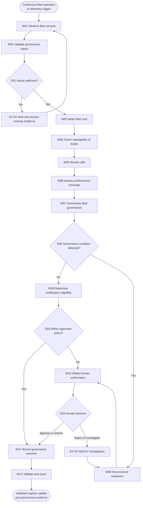
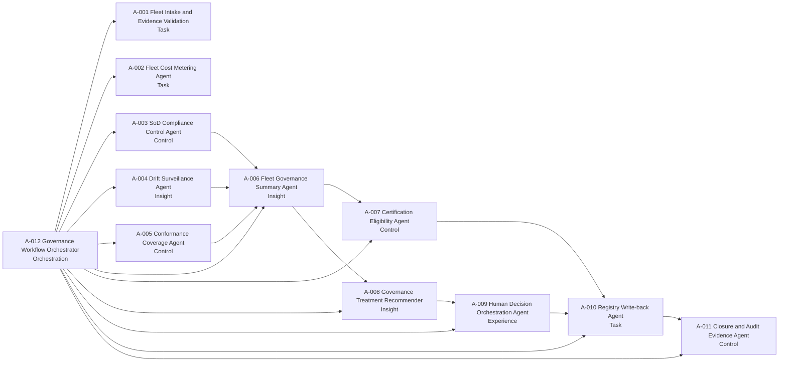

# Executive Summary

This Stage 4 deliverable classifies the AgentOps Control Tower business capability into a governed agent model for Continuous Agent Workforce Management, using the Stage 4 method as the primary authority and Stage 3 decomposition as the factual baseline. [SRC-01, Objective; SRC-02, sections 1, 2 and Appendix C]

The deliverable provides all mandatory Stage 4 outputs:
- agent inventory per workflow step;
- approved agent-type classification;
- internal orchestration;
- explicit handovers to previous and next steps;
- one control point per workflow step;
- component framework for each classified agent;
- ABBA reuse assessment and variance log. [SRC-01, Outputs of Stage 4]

Classification outcome summary:
- 12 workflow steps classified (W01-W12);
- 12 component agents defined (A-001 to A-012);
- all five approved Stage 4 agent types represented;
- 12 control points (C-001 to C-012), one per step;
- 9 major handovers (H-001 to H-009) and 7 key dependencies maintained from Stage 3;
- 8 ABBA candidates assessed, with 7 Adapted and 1 New design.

The capability remains control-plane critical and human-accountability constrained: onboarding, scope/autonomy increases, kill-switch and retirement decisions remain human-confirmed. [SRC-03, section 5.7]

# Overall AI Framework

## Capability framing

| Field | Definition | Evidence |
|---|---|---|
| Business capability | Continuous Agent Workforce Management | [SRC-03, Part 1 value stream table] |
| Business agent | HR-GOV-001 AgentOps Control Tower | [SRC-03, section 6.7] |
| Purpose | Govern the digital workforce through registry control, SoD assurance, drift monitoring and conformance evidence | [SRC-03, sections 5.7 and 6.7] |
| Business outcome | Digital workforce governed as a workforce, with registry integrity and conformance tracking | [SRC-03, Part 1 value stream table] |
| Stage boundary | Business capability classification and orchestration design, not technical implementation architecture | [SRC-01, Practitioner guidance] |

## Stage 4 deliverables baseline

| Deliverable item | Stage 4 requirement | How this document satisfies it | Evidence |
|---|---|---|---|
| Agent inventory per workflow step | Mandatory | Section Workflow Decomposition Catalogue maps W01-W12 to A-001 to A-012 | [SRC-01, Outputs of Stage 4] |
| Agent classifications | Mandatory | Each agent assigned to Task, Insight, Orchestration, Control, Experience | [SRC-01, Agent type legend] |
| Internal orchestration diagrams | Mandatory | End-to-End and Internal Agent Orchestration Mermaid maps included | [SRC-01, Outputs of Stage 4] |
| Handovers previous/next | Mandatory | Handover and Interaction Register includes source, destination, artefact, controls | [SRC-01, activity 5] |
| Control point for every step | Mandatory | C-001 to C-012 mapped 1:1 to workflow steps | [SRC-01, activity 6] |
| Framework for each agent | Mandatory | Appendix A includes detailed framework cards for A-001 to A-012 | [SRC-01, activity 7] |
| ABBA reuse assessment and variance log | Mandatory | Appendix B includes ABBA candidate assessment outcomes and adaptation notes | [SRC-01, activity 8; SRC-04, relevant rows] |

## Stage 4 source register

| Source ID | Source | Role in Stage 4 | Precedence |
|---|---|---|---|
| SRC-01 | Delivery-Control/Stage_4.md | Authoritative Stage 4 objective, activities, outputs, controls and agent types | 1 |
| SRC-02 | Stage 3 Output/Agent_Ops_Control_Tower_Stage3_Decompose.md | Step-level decomposition, decisions, exceptions, handovers, HIPs and open items | 2 |
| SRC-03 | Source Documents/HR_Capability_and_Full_Agent_Catalogue_v1.md | Capability context, deterministic functions, governance boundaries and systems of record | 2 |
| SRC-04 | ABBA-Reuse-Agents/Annotated_Agents_H2RList.csv | Reuse candidate base for Stage 4 adaptation and variance decisions | 3 |
| SRC-05 | Delivery-Control/Enterprise_Business_Data_Objects_Overview_extracted.txt | Enterprise object families and governance object alignment for control/evidence modelling | 2 |

# End-to-End Workflow

## Workflow objective

Classify and orchestrate agents that run the governance cycle Observe -> Validate -> Meter -> Check -> Monitor -> Assess -> Decide -> Confirm -> Record -> Validate/Close while preserving human accountability for consequential actions. [SRC-02, sections 5, 6 and 8; SRC-03, sections 5.7 and 6.7]

## End-to-end process map

## Internal agent orchestration map

# Workflow Decomposition Catalogue

## Agent inventory and classification by workflow step

| Step ID | Step name | Operation | Assigned agent(s) | Agent type(s) | Control point | Input from previous | Output to next | Evidence |
|---|---|---|---|---|---|---|---|---|
| W01 | Observe fleet records | Read | A-001, A-012 | Task, Orchestration | C-001 Telemetry completeness control | Triggered telemetry and registry feed | Curated assessment input package | [SRC-02, section 6.2 W01; SRC-03, sections 4.1 and 6.7] |
| W02 | Validate governance inputs | Validate | A-001, A-003 | Task, Control | C-002 Mandatory evidence gate | Assessment input package | Validated set or EX-01 hold | [SRC-02, section 6.2 W02; SRC-03, section 5.7 Inputs] |
| W03 | Meter fleet cost | Read, Derive | A-002 | Task | C-003 Deterministic cost check | Validated data inputs | Fleet cost metric | [SRC-02, section 6.2 W03; SRC-03, tool fleet_meter] |
| W04 | Check segregation of duties | Read, Validate, Derive | A-003 | Control | C-004 SoD rule control | Costed fleet activity set | SoD status and violation flags | [SRC-02, section 6.2 W04; SRC-03, tool sod_check] |
| W05 | Monitor drift | Read, Validate, Derive | A-004 | Insight | C-005 Drift threshold control | SoD-checked fleet set | Drift signal set | [SRC-02, section 6.2 W05; SRC-03, section 5.7 deterministic requirements] |
| W06 | Assess conformance coverage | Read, Validate, Derive | A-005 | Control | C-006 Coverage compliance control | Drift-marked fleet set | Conformance percentage and gap flags | [SRC-02, section 6.2 W06; SRC-03, tool compliance_coverage] |
| W07 | Summarise fleet governance | Read, Derive | A-006 | Insight | C-007 Summary integrity check | Cost, SoD, drift, conformance outputs | Fleet governance summary | [SRC-02, section 6.2 W07; SRC-03, tool fleet_summary] |
| W08 | Determine certification eligibility | Read, Validate, Derive | A-007 | Control | C-008 Policy boundary control | Governance summary + policy constraints | In-policy certification or human-review route | [SRC-02, section 6.2 W08; SRC-03, sections 5.7 and 6.7] |
| W09 | Recommend governance treatment | Read, Derive | A-008 | Insight | C-009 Recommendation evidence control | Governance condition findings | Recommended tune/restrict/retire action | [SRC-02, section 6.2 W09; SRC-03, section 6.7 generic script] |
| W10 | Obtain human confirmation | Read, Approve | A-009 | Experience | C-010 Segregation and approval control | Recommendation and evidence pack | Attributable human decision | [SRC-02, sections 6.2 W10 and 8.3; SRC-03, section 5.7 HITL boundary] |
| W11 | Record governance outcome | Update | A-010 | Task | C-011 Authorised write-back control | Certification outcome or human decision | Committed registry outcome | [SRC-02, section 6.2 W11; SRC-03, section 6.7 systems of record] |
| W12 | Validate and close | Read, Validate, Create | A-011 | Control | C-012 Closure evidence control | Committed outcome and trace logs | Validated closure and audit artefact | [SRC-02, section 6.2 W12; SRC-03, section 4.4 audit trail schema] |

## Workflow-step deliverables detail

| Deliverable ID | Deliverable item | Description of completion requirement | Produced by |
|---|---|---|---|
| DLV-4-01 | Per-step agent inventory | Every step has explicit assigned agent(s) with unique IDs | Workflow Decomposition Catalogue |
| DLV-4-02 | Per-step classification | Every assigned agent mapped to approved Stage 4 type(s) | Workflow Decomposition Catalogue |
| DLV-4-03 | Internal orchestration | Sequencing and interaction of agents captured in Mermaid | End-to-End Workflow section |
| DLV-4-04 | Step handovers | Input and output boundaries for each step documented | Workflow Decomposition and Handover Register |
| DLV-4-05 | Step control point | Exactly one mandatory control point at each step | Control mapping C-001 to C-012 |
| DLV-4-06 | Agent framework card | Full framework card for each A-001 to A-012 | Appendix A |
| DLV-4-07 | ABBA reuse and variance log | Reuse decision and adaptation impact recorded for each ABBA candidate | Appendix B |

# Handover and Interaction Register

| Handover ID | From | To | Artefact / information | Producing performer | Consuming performer | Preconditions | Postconditions | Failure mode | Evidence |
|---|---|---|---|---|---|---|---|---|---|
| H-001 | External telemetry and registry sources | W01/A-001 | Action, cost, decision logs; registry records; policy references | Any registered agent and source system | AgentOps Control Tower | Trigger event available | Input package assembled | Missing or stale evidence | [SRC-02, H01 and H02; SRC-03, section 4.1] |
| H-002 | W01/A-001 | W02/A-003 | Curated evidence package | AgentOps Control Tower | AgentOps Control Tower | Required inputs collected | Validation decision emitted | Evidence sufficiency failure (EX-01) | [SRC-02, W01-W02 and D01] |
| H-003 | W02/A-001 | W03/A-002 | Validated input set | AgentOps Control Tower | AgentOps Control Tower | D01 = Yes | Cost metering starts | Input integrity defect | [SRC-02, W02-W03] |
| H-004 | W03/A-002 | W04/A-003 | Fleet cost run context and activity records | AgentOps Control Tower | AgentOps Control Tower | Deterministic meter completed | SoD check issued | Telemetry blind spot | [SRC-02, W03-W04; SRC-03, risks] |
| H-005 | W04/A-003 + W05/A-004 + W06/A-005 | W07/A-006 | SoD, drift and conformance outputs | AgentOps Control Tower | AgentOps Control Tower | Deterministic checks completed | Fleet summary available | Inconsistent metric joins | [SRC-02, W04-W07; SRC-03, tools list] |
| H-006 | W07/A-006 | W08/A-007 and W09/A-008 | Governance summary and condition indicators | AgentOps Control Tower | AgentOps Control Tower | Summary quality check passed | Eligibility and treatment paths populated | Ambiguous policy boundary | [SRC-02, H04 and D02; SRC-03, section 5.7] |
| H-007 | W09/A-008 | W10/A-009 | Recommendation, rationale, evidence pack | AgentOps Control Tower | Human governance approvers via orchestration | Consequential action identified | Human decision captured | Rejection or request for more evidence | [SRC-02, H05 and D04; SRC-03, section 5.7] |
| H-008 | W08/A-007 or W10/A-009 | W11/A-010 | Certification eligibility or approved human decision | AgentOps Control Tower / approver | Registry write-back performer | Authorisation and SoD checks passed | Outcome committed | Write-back failure | [SRC-02, H06-H08; SRC-03, section 6.7] |
| H-009 | W11/A-010 | W12/A-011 and governance consumers | Registry write-back reference, trace, confirmations | AgentOps Control Tower | Audit and governance consumers | Commit success | Closure evidence retained | Validation failure / re-open | [SRC-02, H09 and D05; SRC-03, section 4.4] |

# Decision Catalogue

| Decision ID | Decision question | Owner | Agent support | Criteria | Outcomes | Linked control | Evidence |
|---|---|---|---|---|---|---|---|
| D-001 | Are mandatory governance inputs sufficient? | AgentOps Control Tower | A-001, A-003 | Presence and freshness of registry, scope, policy, model-card and telemetry records | Proceed or EX-01 hold | C-002 | [SRC-02, D01; SRC-03, section 5.7 Inputs] |
| D-002 | Is a governance condition detected? | AgentOps Control Tower | A-003, A-004, A-005, A-006 | Deterministic SoD, drift and conformance signals | No condition or treatment required | C-004/C-005/C-006/C-007 | [SRC-02, D02; SRC-03, deterministic tools] |
| D-003 | Is in-policy certification permitted? | AgentOps Control Tower | A-007 | Policy boundary conformance and evidence completeness | Certify directly or route to human confirmation | C-008 | [SRC-02, D03; SRC-03, sections 5.7 and 6.7] |
| D-004 | Is the consequential action authorised? | AI Governance Lead plus HR/Finance/IT where required | A-009 | Attributable approval, SoD separation, rationale completeness | Approve, amend, reject, escalate | C-010 | [SRC-02, D04; SRC-03, sections 4.3, 4.4 and 5.7] |
| D-005 | Did write-back and closure validation succeed? | AgentOps Control Tower | A-010, A-011 | Commit reference, validation checks, evidence retention | Close or re-open remediation path | C-011/C-012 | [SRC-02, D05; SRC-03, section 6.7] |

# Exception Catalogue

| Exception ID | Trigger | Detection point | Handling route | Ownership | Re-entry point | Evidence |
|---|---|---|---|---|---|---|
| E-001 | Missing or stale governance evidence | W02 / D-001 | Hold, remediate source evidence, then re-validate | Source owner and AI Governance Lead | W01 | [SRC-02, EX-01] |
| E-002 | Drift condition identified | W05 / D-002 | Generate treatment recommendation and route for decision | AI Governance Lead | W09 | [SRC-02, EX-02; SRC-03, section 6.7] |
| E-003 | SoD violation detected | W04 / D-002 | Flag non-compliant, block direct certification path | AI Governance Lead | W09 | [SRC-02, EX-03; SRC-03, section 5.7] |
| E-004 | Conformance coverage below requirement | W06 / D-002 | Record gap and require remediation plan | AI Governance Lead | W09 | [SRC-02, EX-04] |
| E-005 | Cost telemetry blind spot | W03 / D-001 | Qualify or hold result until telemetry gap closed | Source system owner | W01 | [SRC-02, EX-05; SRC-03, risks] |
| E-006 | Unregistered agent discovered | W01 / D-001 | Escalate for registration before certification | AI Governance Lead | W01 | [SRC-02, EX-06; SRC-03, section 5.7 risks] |
| E-007 | Recommendation rejected or insufficiently evidenced | W10 / D-004 | Investigate, enrich evidence or close without change | Human decision authority | W09 | [SRC-02, EX-07] |
| E-008 | Write-back or closure validation failed | W11-W12 / D-005 | Preserve prior state, remediate, retry validation | Source owner and governance operator | W11 | [SRC-02, EX-08; SRC-03, section 6.7] |

# Human Intervention Points

| HIP ID | Workflow location | Required human role | Why human judgement is required | Input evidence set | Expected output |
|---|---|---|---|---|---|
| HIP-001 | W10 / D-004 | AI Governance Lead | Consequential governance actions must be attributable and accountable | Recommendation, risk rationale, trace and control signals | Approved, amended or rejected decision | 
| HIP-002 | W10 / D-004 | AI Governance Lead | Scope or autonomy increases change risk posture and require explicit approval | Governance summary plus policy boundary assessment | Approval decision with rationale |
| HIP-003 | W10 / D-004 | Authorised kill-switch authority | Kill-switch and retirement are always human-confirmed | Incident context, drift/SoD/conformance evidence | Confirmed containment or retirement decision |
| HIP-004 | W10 / D-004 | HR, Finance and IT joint authority | Digital establishment changes are cross-functional decisions | Establishment recommendation and impact evidence | Joint decision and sign-off record |
| HIP-005 | EX pathways | AI Governance Lead | Exception resolution may require trade-off judgement beyond deterministic rules | Exception evidence and remediation options | Resolution route and closure condition |

Evidence for HIP-001 to HIP-005: [SRC-02, section 8.3; SRC-03, sections 4.3, 4.4 and 5.7]

# SME Validation and Confirmation

## Validation checklist for Stage 4 completion

| Validation ID | Validation topic | Completion criterion | Status |
|---|---|---|---|
| SV-4-01 | Agent inventory completeness | Every workflow step has one or more assigned agents and a control point | Draft complete, pending SME sign-off |
| SV-4-02 | Classification quality | Agent type assignments accepted by business and governance SMEs | Pending |
| SV-4-03 | Handover integrity | Handover artefacts, producers, consumers, and controls accepted | Pending |
| SV-4-04 | Decision and exception coverage | All major branches represented with ownership and re-entry logic | Pending |
| SV-4-05 | Human intervention boundary | HITL points and approval authorities validated | Pending |
| SV-4-06 | ABBA reuse outcome acceptance | Reuse/adapt/new decisions accepted for Stage 5 modelling | Pending |
| SV-4-07 | Open issue carry-forward | Stage 3 open items accepted for Stage 4 onward management | Pending |

## Controlled carry-forward from Stage 3

| Carry-forward ID | Description | Stage 4 impact | Stage 5 requirement | Evidence |
|---|---|---|---|---|
| ACO-01 | Owner naming conflict (AI Governance/AgentOps Lead vs HR Governance Lead) | Impacts ownership attribution in frameworks | Confirm canonical owner role for all framework cards | [SRC-02, sections 3.1 and 9.2; SRC-03, sections 4.2 and 6.7] |
| ACO-02 | L2 versus L3 policy boundary ambiguity | Impacts certification gate logic in W08 | Approve explicit autonomous-certification policy statement | [SRC-02, sections 1 and 3.4; SRC-03, sections 5.7 and 6.7] |
| ACO-03 | Trigger/cadence not formally approved | Impacts entry criteria controls | Define operational trigger catalogue and cadence SLA | [SRC-02, section 3.4; SRC-03, section 4.1] |
| ACO-04 | Closure criteria incomplete | Impacts W12 closure control test | Approve formal closure and re-open criteria | [SRC-02, sections 3.4 and 5.1] |
| ACO-08 | Data/system ownership gaps | Impacts handover accountability and control ownership | Complete data owner, steward and source owner assignments | [SRC-02, sections 3.4 and 7.2] |

# Stage 4 to Stage 5 Handover

## Stage 5-ready assets produced

| Handover item | Stage 4 output produced | Stage 5 modelling use |
|---|---|---|
| Workflow-step-to-agent map | W01-W12 mapped to A-001 to A-012 | Defines component boundaries for Stage 5 data modelling |
| Agent classification set | Stage 4 type assignments across Task, Insight, Orchestration, Control, Experience | Drives operating pattern and model/data design choices |
| Control map | C-001 to C-012 | Input to Stage 5 control data and evidencing schema |
| Handover register | H-001 to H-009 | Input to Stage 5 interface contracts and event/data flows |
| Decision/exception/HIP registers | D-001 to D-005, E-001 to E-008, HIP-001 to HIP-005 | Input to policy logic, escalation paths and approvals model |
| ABBA reuse outcomes | Reuse/adaptation decisions and variance notes | Input to build-vs-reuse design and effort estimation |
| Agent framework cards | A-001 to A-012 complete component framework | Primary Stage 5 component baseline |

## Stage 5 actions required

1. Resolve all open ownership and policy boundary items (ACO-01, ACO-02, ACO-08).
2. Define data contracts for each handover artefact and control check.
3. Finalise deterministic thresholds for drift, conformance, and exception severity.
4. Confirm target runtime and deployment decisions currently marked TBD in the capability catalogue.
5. Translate framework cards into Stage 5 component data/input/output models.

# Appendices

## Appendix A - Component AI Framework cards (A-001 to A-012)

### A-001 Fleet Intake and Evidence Validation Agent

| Field | Definition |
|---|---|
| Agent ID | A-001 |
| Primary type | Task |
| Purpose | Collect and validate required registry, telemetry and policy evidence for governance assessment |
| Workflow steps | W01-W02 |
| Inputs | AgentReg records, model-card references, policy references, telemetry logs |
| Outputs | Curated and validated evidence package |
| Behaviour | Read -> validate completeness -> issue sufficiency decision |
| Exceptions | Missing/stale evidence (E-001) |
| Controls | C-001, C-002 |
| Human interaction | None by default; escalates evidence gaps |
| Reuse outcome | Adapted from ABBA control/data validation patterns |
| Evidence | [SRC-02, W01-W02; SRC-03, section 5.7; SRC-04, VA-1172] |

### A-002 Fleet Cost Metering Agent

| Field | Definition |
|---|---|
| Agent ID | A-002 |
| Primary type | Task |
| Purpose | Compute deterministic digital-labour cost metrics |
| Workflow steps | W03 |
| Inputs | Cost per run, run count, workload telemetry |
| Outputs | Fleet cost metric and trace |
| Behaviour | Deterministic derivation via fleet_meter pattern |
| Exceptions | Telemetry blind spot (E-005) |
| Controls | C-003 |
| Human interaction | Not required for normal operation |
| Reuse outcome | Adapted |
| Evidence | [SRC-02, W03; SRC-03, tools table fleet_meter] |

### A-003 SoD Compliance Control Agent

| Field | Definition |
|---|---|
| Agent ID | A-003 |
| Primary type | Control |
| Purpose | Detect and evidence segregation-of-duties violations |
| Workflow steps | W02, W04 |
| Inputs | Action and approval logs, actor identifiers |
| Outputs | SoD status and violation evidence |
| Behaviour | Rule checks over initiator versus approver patterns |
| Exceptions | SoD breach (E-003) |
| Controls | C-004 |
| Human interaction | Escalates to governance authority for consequential actions |
| Reuse outcome | Adapted |
| Evidence | [SRC-02, W04 and EX-03; SRC-03, sections 4.3 and 5.7] |

### A-004 Drift Surveillance Agent

| Field | Definition |
|---|---|
| Agent ID | A-004 |
| Primary type | Insight |
| Purpose | Identify model or behaviour drift against baseline indicators |
| Workflow steps | W05 |
| Inputs | Evaluation telemetry, baseline data |
| Outputs | Drift indicators and severity flags |
| Behaviour | Compare telemetry to baseline thresholds |
| Exceptions | Drift condition (E-002) |
| Controls | C-005 |
| Human interaction | Provides recommendation evidence for human confirmation path |
| Reuse outcome | New design |
| Evidence | [SRC-02, W05 and EX-02; SRC-03, section 5.7] |

### A-005 Conformance Coverage Agent

| Field | Definition |
|---|---|
| Agent ID | A-005 |
| Primary type | Control |
| Purpose | Compute and flag conformance coverage against AI governance obligations |
| Workflow steps | W06 |
| Inputs | Registry conformance evidence set |
| Outputs | Coverage percentage and gap flags |
| Behaviour | Deterministic coverage calculation |
| Exceptions | Conformance gap (E-004) |
| Controls | C-006 |
| Human interaction | Escalates shortfall outcomes |
| Reuse outcome | Adapted |
| Evidence | [SRC-02, W06 and EX-04; SRC-03, tool compliance_coverage] |

### A-006 Fleet Governance Summary Agent

| Field | Definition |
|---|---|
| Agent ID | A-006 |
| Primary type | Insight |
| Purpose | Consolidate cost, SoD, drift and coverage into a governance summary |
| Workflow steps | W07 |
| Inputs | Outputs from A-002, A-003, A-004, A-005 |
| Outputs | Fleet governance summary artefact |
| Behaviour | Deterministic aggregation and prioritised summarisation |
| Exceptions | Inconsistent or incomplete aggregates |
| Controls | C-007 |
| Human interaction | None direct; feeds decision routes |
| Reuse outcome | Adapted |
| Evidence | [SRC-02, W07; SRC-03, tool fleet_summary] |

### A-007 Certification Eligibility Agent

| Field | Definition |
|---|---|
| Agent ID | A-007 |
| Primary type | Control |
| Purpose | Determine if certification can proceed within approved policy boundaries |
| Workflow steps | W08 |
| Inputs | Governance summary and policy constraints |
| Outputs | Eligibility decision and rationale |
| Behaviour | Policy-rule evaluation with boundary checks |
| Exceptions | Policy ambiguity or missing boundary evidence |
| Controls | C-008 |
| Human interaction | Routes out-of-policy cases to human decision orchestration |
| Reuse outcome | Adapted |
| Evidence | [SRC-02, W08 and D03; SRC-03, sections 5.7 and 6.7] |

### A-008 Governance Treatment Recommender

| Field | Definition |
|---|---|
| Agent ID | A-008 |
| Primary type | Insight |
| Purpose | Recommend tune, restrict or retire actions for governance conditions |
| Workflow steps | W09 |
| Inputs | Drift/SoD/conformance condition evidence |
| Outputs | Recommended treatment and rationale |
| Behaviour | Rule-guided recommendation generation |
| Exceptions | Recommendation rejected or challenged (E-007) |
| Controls | C-009 |
| Human interaction | Supports consequential decision-making, no autonomous execution |
| Reuse outcome | Adapted |
| Evidence | [SRC-02, W09 and EX-07; SRC-03, section 6.7 generic script] |

### A-009 Human Decision Orchestration Agent

| Field | Definition |
|---|---|
| Agent ID | A-009 |
| Primary type | Experience |
| Purpose | Coordinate attributable human review and approval workflow |
| Workflow steps | W10 |
| Inputs | Recommendation pack, policy and SoD context |
| Outputs | Human decision record with identity, timestamp and rationale |
| Behaviour | Route to authority, gather response, enforce approval evidence quality |
| Exceptions | Rejection or investigation loop |
| Controls | C-010 |
| Human interaction | Core function is human interaction and decision capture |
| Reuse outcome | Adapted |
| Evidence | [SRC-02, W10 and HIP-01 to HIP-05; SRC-03, section 4.4] |

### A-010 Registry Write-back Agent

| Field | Definition |
|---|---|
| Agent ID | A-010 |
| Primary type | Task |
| Purpose | Write approved governance outcomes to the agent registry |
| Workflow steps | W11 |
| Inputs | Authorised certification or treatment decision |
| Outputs | Committed registry reference |
| Behaviour | Controlled write-back lifecycle: proposed -> approved -> committed -> confirmed |
| Exceptions | Write-back failure (E-008) |
| Controls | C-011 |
| Human interaction | Uses prior approved decision only |
| Reuse outcome | Adapted |
| Evidence | [SRC-02, W11 and H08; SRC-03, section 6.7 systems of record] |

### A-011 Closure and Audit Evidence Agent

| Field | Definition |
|---|---|
| Agent ID | A-011 |
| Primary type | Control |
| Purpose | Validate committed outcomes and retain governance-grade closure evidence |
| Workflow steps | W12 |
| Inputs | Registry commit reference, traces, confirmations |
| Outputs | Closure record and audit evidence artefact |
| Behaviour | Validation checks and evidence retention according to policy |
| Exceptions | Validation failure requiring re-open |
| Controls | C-012 |
| Human interaction | Provides review-ready evidence to governance and audit users |
| Reuse outcome | Adapted |
| Evidence | [SRC-02, W12 and D05; SRC-03, section 4.4] |

### A-012 Governance Workflow Orchestrator Agent

| Field | Definition |
|---|---|
| Agent ID | A-012 |
| Primary type | Orchestration |
| Purpose | Coordinate sequencing, dependencies and route control across W01-W12 |
| Workflow steps | W01-W12 |
| Inputs | Trigger events, status outputs from component agents |
| Outputs | Ordered execution and route transitions |
| Behaviour | Execute end-to-end route logic and exception branches |
| Exceptions | Route deadlock or unresolved branch criteria |
| Controls | Cross-step orchestration integrity control |
| Human interaction | Surfaces branch and exception states for governance visibility |
| Reuse outcome | Adapted |
| Evidence | [SRC-01, activity 4; SRC-02, sections 5 to 8; SRC-04, VA-1334] |

## Appendix B - ABBA reuse assessment and variance log

| ABBA AgentID | ABBA agent name | ABBA type | Capability relevance | Stage 4 mapping | Reuse outcome | Adaptation / variance note | Evidence |
|---|---|---|---|---|---|---|---|
| VA-1172 | Data validation agent | Control Agent | Validating governance evidence completeness | A-001, A-003 | Adapted | Extended to include registry, telemetry and policy sufficiency checks | [SRC-04, row containing VA-1172; SRC-02, W02] |
| VA-1304 | Data governance monitor | Control Agent | Governance policy conformance checks | A-005 | Adapted | Refocused to AI Act/ISO 42001 coverage controls | [SRC-04, row containing VA-1304; SRC-03, section 5.7] |
| VA-1301 | Data repository manager | Task Agent | Registry write-back and stewardship | A-010 | Adapted | Tailored to registry commit lifecycle and evidence linkage | [SRC-04, row containing VA-1301; SRC-03, section 6.7] |
| VA-1334 | System governance orchestrator | Process Agent | Cross-workflow orchestration | A-012 | Adapted | Aligned to AgentOps governance route logic and exceptions | [SRC-04, row containing VA-1334; SRC-02, workflow map] |
| VA-1338 | System compliance monitor | Control Agent | Compliance and standards monitoring | A-005, A-011 | Adapted | Enhanced for closure evidence and audit-grade confirmation | [SRC-04, row containing VA-1338; SRC-03, section 4.4] |
| VA-1178 | Auto-flag and report exceptions agent | Control Agent | Exception detection and signalling | A-004, A-008 | Adapted | Extended for drift plus governance-treatment recommendations | [SRC-04, row containing VA-1178; SRC-02, EX-02 to EX-04] |
| VA-1101 | Feedback and certification workflow agent | Process Agent | Certification route management | A-007, A-009 | Adapted | Recast to governance certification and attributable human approval | [SRC-04, row containing VA-1101; SRC-02, D03-D04] |
| N/A | Drift-specific governance surveillance capability | N/A | Explicit drift surveillance for cross-domain agent estate | A-004 | New design | No direct ABBA candidate with equivalent fleet drift scope located in reviewed rows | [SRC-04, reviewed matches; SRC-03, section 6.7] |

## Appendix C - Control point register

| Control ID | Workflow step | Control type | Control description | Owner | Evidence |
|---|---|---|---|---|---|
| C-001 | W01 | Embedded control | Telemetry completeness check at intake | AgentOps Control Tower | [SRC-02, H01-H02] |
| C-002 | W02 | Deterministic rule | Mandatory evidence sufficiency gate | AgentOps Control Tower | [SRC-02, D01] |
| C-003 | W03 | Deterministic rule | Cost metering reproducibility check | AgentOps Control Tower | [SRC-03, fleet_meter] |
| C-004 | W04 | Control Agent | SoD violation detection and block | AgentOps Control Tower | [SRC-03, sod_check] |
| C-005 | W05 | Deterministic rule | Drift threshold and severity rule | AgentOps Control Tower | [SRC-02, W05] |
| C-006 | W06 | Control Agent | Conformance coverage compliance check | AgentOps Control Tower | [SRC-03, compliance_coverage] |
| C-007 | W07 | Audit check | Multi-signal summary integrity verification | AgentOps Control Tower | [SRC-02, W07] |
| C-008 | W08 | Deterministic rule | Policy boundary and eligibility gate | AgentOps Control Tower | [SRC-02, D03] |
| C-009 | W09 | Human review pre-control | Recommendation evidence quality check | AgentOps Control Tower | [SRC-02, W09] |
| C-010 | W10 | Human approval | Attributable human confirmation with SoD | AI Governance Lead plus designated approvers | [SRC-03, section 5.7] |
| C-011 | W11 | Embedded control | Authorised write-back lifecycle control | Registry write-back performer | [SRC-03, section 6.7] |
| C-012 | W12 | Audit check | Closure and evidence validation control | AgentOps Control Tower | [SRC-03, section 4.4] |

## Appendix D - Stage 4 output completion statement

This document is review-ready as a Stage 4 classification draft and includes all mandatory output artefacts specified in Stage 4 methodology.

Open validation constraints remain:
- SME sign-off has not yet been provided;
- owner-role naming and L2/L3 policy boundary confirmation remain open carry-forwards;
- specific source-system ownership, trigger cadence and closure criteria require formal confirmation.

These constraints do not invalidate the Stage 4 decomposition and classification content, but they remain governance gates for formal completion.
