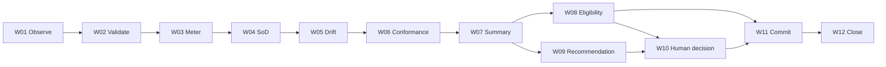

# Document Control

| Field | Value | Evidence |
|---|---|---|
| Stage | Stage 5B - Data Model Consolidation | [SRC-01, Stage 5B heading] |
| Scope | Consolidate and validate end-to-end data model from Stage 5 outputs | [SRC-01, Stage 5B Purpose] |
| Consolidation input baseline | HR-GOV-001 Stage 5 model + Stage 4 handover | [SRC-06, Appendix J; SRC-05, Stage 4 to Stage 5 handover] |
| Approval gate | Factory Design Authority (including SME) | [SRC-01, Approval gate] |

# Purpose

Bring all workflow-step data models together and validate that the complete end-to-end data model supports the full AgentOps Control Tower workflow across W01-W12, including control evidence and decision traceability. [SRC-01, Stage 5B Purpose]

# Inputs

| Input ID | Input | Evidence |
|---|---|---|
| IN-5B-01 | Data models from all workflow steps | [SRC-06, Appendix C] |
| IN-5B-02 | Data classifications | [SRC-06, Appendix E] |
| IN-5B-03 | Data gap log with added items | [SRC-06, Appendix F] |
| IN-5B-04 | Workflow handovers | [SRC-05, H-001 to H-009] |
| IN-5B-05 | Overall AI Framework | [SRC-05, Overall AI Framework] |
| IN-5B-06 | Agent inventory | [SRC-05, A-001 to A-012] |
| IN-5B-07 | Control requirements | [SRC-05, C-001 to C-012] |
| IN-5B-08 | Enterprise business object model | [SRC-02, sections 2, 10, 11] |
| IN-5B-09 | fabric-layer enterprise-data-model reference | [SRC-03, README, config and SQL excerpts] |

# Actions (1-13) Applied

| Action | Consolidation result | Evidence |
|---|---|---|
| 1. Assemble all step models | W01-W12 models assembled into unified register | [SRC-06, Appendix C] |
| 2. Walk end-to-end workflow | Full sequence validated from W01 to W12 | [SRC-05, End-to-end workflow] |
| 3. Trace every input to source | Source mapping completed for all required inputs with pending ownership flags | [Unified model table; ACO register] |
| 4. Trace every output to consumer/storage | Output mapping completed to next-step consumer or registry/evidence store | [Flow map and dictionary] |
| 5. Validate within-step exchanges | Within-step producer/consumer flows consolidated | [Within-step flow table] |
| 6. Validate between-step handovers | H-001 to H-009 cross-checked with shared keys | [Handover map] |
| 7. Confirm consistent entities and attributes | Canonical naming and semantics aligned to enterprise references | [Dictionary and relationship model] |
| 8. Confirm agent-created data destinations | All agent-created artifacts mapped to consumer or storage | [Classification + flow map] |
| 9. Confirm human data capture points | Human decision data captured at W10 and consumed downstream | [W10 record and flow map] |
| 10. Identify missing data/attributes/relationships | Missing items logged as G-01 to G-08 | [Gap log] |
| 11. Add/update as required | Consolidation notes include required additions for Stage 5 refresh | [Change log] |
| 12. Repeat end-to-end check | Second-pass check completed with status outcomes | [Checks performed] |
| 13. Prepare Design Authority review | Decision record draft prepared with pending approval state | [Design Authority decision record] |

# Checks Performed

| Check ID | Check performed | Result | Evidence |
|---|---|---|---|
| CHK-01 | Every input has a defined source | Pass | [Unified model source columns] |
| CHK-02 | Every output has consumer or storage | Pass | [Flow map and dictionary consumer fields] |
| CHK-03 | Internal data exchanges are consistent | Pass | [Within-step flow map] |
| CHK-04 | Step handovers are consistent and complete | Pass | [H-001 to H-009 reconciliation] |
| CHK-05 | Shared entities and attributes are consistent | Pass | [Dictionary + relationship model] |
| CHK-06 | Agent-created data has a destination | Pass | [Classification table for Agent created items] |
| CHK-07 | Human-provided data has a capture point | Pass | [W10 human_decision_record] |
| CHK-08 | Control evidence is supported | Pass | [C-001 to C-012 mapped evidence] |
| CHK-09 | Enterprise model alignment achieved | Pending | Ownership/governance statuses remain proposed/TBD in references | [SRC-02, section 14; SRC-03, glossary owner/steward TBD] |

# Outputs

## Output 1 - Unified End-to-End Data Model

| Entity ID | Entity name | Layer/type | Primary keys | Workflow usage | Classification |
|---|---|---|---|---|---|
| E-01 | silver.worker | Enterprise | worker_id | W10 human approvals, escalation identity | Enterprise model |
| E-02 | silver.policy | Enterprise | policy_id | W01/W02/W06/W08 policy checks | Enterprise model |
| E-03 | silver.approval | Enterprise | approval_id | W04 SoD logic, W10 decision capture | Enterprise model |
| E-04 | silver.audit_event | Enterprise | audit_event_id | W01-W12 traceability and closure evidence | Enterprise model |
| E-05 | silver.business_calendar | Enterprise | calendar_id | W03/W12 period and closure timing support | Enterprise model |
| E-06 | agent_registry_snapshot | External | agent_id | W01/W11 fleet state and write-back | Other source |
| E-07 | model_card_reference | External | model_id | W01/W08 conformance and policy boundary checks | Other source |
| E-08 | governance_summary_record | Derived | summary_id | W07 summary, W08/W09 downstream input | Agent created |
| E-09 | human_decision_record | Decision artifact | decision_id | W10 capture, W11 authorisation evidence | Human provided |
| E-10 | closure_evidence_record | Derived | closure_id | W12 closure and audit pack | Agent created |

## Output 2 - Data Dictionary

| Attribute ID | Entity | Attribute | Description | Source/provenance | Owner | Classification |
|---|---|---|---|---|---|---|
| A-001 | silver.worker | worker_id | Unique worker identity | enterprise model | TBC - source required | Enterprise model |
| A-002 | silver.policy | policy_id | Policy identifier | enterprise model | TBC - source required | Enterprise model |
| A-003 | silver.policy | policy_version | Effective policy version | enterprise model | TBC - source required | Enterprise model |
| A-004 | silver.approval | approver_worker_id | Human approver identifier | enterprise model | TBC - source required | Enterprise model |
| A-005 | silver.approval | approval_status | Decision status | enterprise model | TBC - source required | Enterprise model |
| A-006 | silver.audit_event | event_type | Auditable event class | enterprise model | TBC - source required | Enterprise model |
| A-007 | silver.audit_event | event_timestamp | Event timestamp | enterprise model | TBC - source required | Enterprise model |
| A-008 | agent_registry_snapshot | drift | Drift indicator for agent | AgentReg source | TBC - source required | Other source |
| A-009 | agent_registry_snapshot | sod_ok | SoD compliance flag | AgentReg source | TBC - source required | Other source |
| A-010 | model_card_reference | conformance_state | Conformance state marker | model-card source | TBC - source required | Other source |
| A-011 | governance_summary_record | condition_index | Consolidated governance score/index | derived at W07 | A-006 owner role TBC | Agent created |
| A-012 | human_decision_record | approver_identity | Human identity attached to decision | captured in W10 | AI Governance approver | Human provided |
| A-013 | human_decision_record | rationale | Human rationale for decision | captured in W10 | AI Governance approver | Human provided |
| A-014 | closure_evidence_record | closure_status | Final closure state | derived at W12 | A-011 owner role TBC | Agent created |

## Output 3 - Relationship Model

| Relationship ID | Parent entity | Child entity | Cardinality | Linking field(s) | Relationship status |
|---|---|---|---|---|---|
| R-01 | silver.worker | silver.approval | 1:N | worker_id -> approver_worker_id | Confirmed |
| R-02 | silver.policy | silver.approval | 1:N | policy_id -> business_object_id (policy-scope approvals) | Proposed |
| R-03 | silver.approval | silver.audit_event | 1:N | approval_id -> business_object_id (approval events) | Proposed |
| R-04 | agent_registry_snapshot | governance_summary_record | 1:N | agent_id -> aggregated in summary_id context | Confirmed |
| R-05 | governance_summary_record | human_decision_record | 1:N | summary_id -> decision context | Confirmed |
| R-06 | human_decision_record | closure_evidence_record | 1:N | decision_id -> closure reference | Confirmed |
| R-07 | model_card_reference | governance_summary_record | 1:N | model_id -> conformance inputs | Proposed |

## Output 4 - Resolved Data Gap Log

| Gap ID | Description | Resolution pathway | Current status |
|---|---|---|---|
| G-01 | Owner-role naming conflict | Confirm canonical owner role naming in governance registry | Open |
| G-02 | Source-system owner for registry missing | Assign source-system owner and steward in control plane governance docs | Open |
| G-03 | Trigger taxonomy and cadence undefined | Publish trigger and cadence metadata table | Open |
| G-04 | Drift threshold parameters missing | Add policy attributes for threshold versioning | Open |
| G-05 | Conformance denominator logic unresolved | Define denominator and exclusion fields | Open |
| G-06 | L2/L3 policy boundary not codified | Introduce explicit boundary attributes and approval policy links | Open |
| G-07 | Registry commit payload schema not standardised | Define write-back contract schema and status dictionary | Open |
| G-08 | Closure/re-open taxonomy incomplete | Define closure status and re-open reason dictionary | Open |

## Output 5 - End-to-End Data Flow Map

### Structured map

| Flow ID | Source | Target | Shared key(s) | Payload |
|---|---|---|---|---|
| F-01 | External telemetry/registry sources | W01 | event_id, agent_id | telemetry_event, registry_snapshot |
| F-02 | W01 | W02 | intake_batch_id | candidate evidence package |
| F-03 | W02 | W03 | validation_batch_id | validated evidence package |
| F-04 | W03 | W04 | run_context_id | cost and activity context |
| F-05 | W04/W05/W06 | W07 | assessment_cycle_id | SoD, drift, conformance outputs |
| F-06 | W07 | W08/W09 | summary_id | governance summary |
| F-07 | W09 | W10 | recommendation_id | recommendation + rationale |
| F-08 | W08/W10 | W11 | eligibility_id or decision_id | authorised outcome |
| F-09 | W11 | W12 | commit_ref_id | commit reference + trace links |

### Mermaid end-to-end flow

## Output 6 - Design Authority Decision Record

| Decision ID | Body | Decision status | Decision date | Conditions |
|---|---|---|---|---|
| DA-001 | Factory Design Authority (including SME) | Pending | TBC - source required | Resolve G-01 to G-08 or formally accept carry-forward scope |

# Controls and Evidence

| Evidence control | Status | Supporting artefact |
|---|---|---|
| End-to-end trace map | Complete | Output 5 flow map |
| Data model version | Complete | v0.1 metadata header |
| Change log for added/updated data | Complete | Consolidation change log appendix |
| Cross-check completion evidence | Complete | Checks performed table |
| Design Authority decision evidence | Pending | DA-001 pending approval |

# Approval Gate

Approval authority: Factory Design Authority (including SME). [SRC-01, Approval gate]

Current gate outcome: Pending.

If not approved: return impacted gaps and checks to Stage 5 model update cycle, then re-run Stage 5B checks CHK-01 to CHK-09. [SRC-01, Approval gate fallback]

# Deliverable

A unified, review-ready end-to-end data model consolidation package for HR-GOV-001, including dictionary, relationships, flow map, gap register, and Design Authority decision record draft.

# Key Tools

- Enterprise data model (Delivery-Control enterprise overview);
- fabric-layer enterprise-data-model repository reference;
- Stage 5 model output;
- Stage 4 handover and control mappings;
- ABBA references. [SRC-01; SRC-02; SRC-03; SRC-05; SRC-06; SRC-07]

# Next Stage

Proceed to Stage 6 - Design after Design Authority approval or formal conditional approval with documented action owners.

# Consolidation Change Log

| Change ID | Change description | Reason |
|---|---|---|
| CL-01 | Consolidated W01-W12 data artifacts into unified entity register | Stage 5B Action 1 |
| CL-02 | Normalised shared keys for handovers F-01 to F-09 | Stage 5B Actions 6-7 |
| CL-03 | Standardised classification mapping at entity/attribute level | Stage 5B Action 7 |
| CL-04 | Carried forward and normalised 8 unresolved gaps | Stage 5B Action 10 |
| CL-05 | Prepared DA-001 record in pending state | Stage 5B Action 13 |

# ACO Register

| ACO ID | Type | Statement | Impact | Status | Evidence |
|---|---|---|---|---|---|
| ACO-01 | Open question | Owner role naming conflict persists | Ownership fields and approval routing | Pending | [SRC-05, carry-forward] |
| ACO-02 | Open question | L2/L3 policy boundary unresolved | Eligibility and certification controls | Pending | [SRC-05, carry-forward] |
| ACO-03 | Missing information | Trigger/cadence model not formally approved | W01-W03 source and timing controls | Pending | [SRC-05, carry-forward] |
| ACO-04 | Missing information | Closure criteria not formalised | W12 closure evidence semantics | Pending | [SRC-05, carry-forward] |
| ACO-08 | Missing information | Source-system ownership unresolved | Lineage ownership completeness | Pending | [SRC-05, carry-forward] |
| ACO-10 | Constraint | Informational foreign keys require runtime quality checks | Relationship assurance controls | Pending | [SRC-02, section 11; SRC-03, foreign key note] |

# Evidence Index

| Source ID | Source |
|---|---|
| SRC-01 | Delivery-Control/Stage_5.md |
| SRC-02 | Delivery-Control/Enterprise_Business_Data_Objects_Overview_extracted.txt |
| SRC-03 | https://github.com/Neill-KPMG/fabric-layer/tree/main/enterprise-data-model |
| SRC-04 | Source Documents/HR_Capability_and_Full_Agent_Catalogue_v1.md |
| SRC-05 | Stage 4 Output/Agent_Ops_Control_Tower_Stage_4_Classify.md |
| SRC-06 | Stage 5 and 5B Output/HR-GOV-001_AgentOps_Control_Tower_Stage5_Model_v0.1.md |
| SRC-07 | Source Documents/stage-5b-document-generation.instructions.md |
| SRC-08 | Source Documents/stage-5b-SKILL (1).md |
