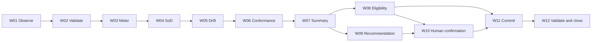

# Document Control

| Field | Value | Evidence |
|---|---|---|
| Methodology basis | Stage 6 objective, inputs, actions, outputs, controls and exit criteria | [SRC-01, Stage 6 section] |
| Scope | Detailed, technology-agnostic design for all agents, controls and handovers in W01-W12 | [SRC-01, Stage 6 objective; SRC-02, W01-W12] |
| Upstream baseline | Stage 4 classified workflow and Stage 5B approved data-model consolidation draft | [SRC-02, W01-W12 and C-001 to C-012; SRC-03, unified model and checks] |
| ABBA reference used | Annotated_Agents_H2RList.csv | [SRC-04, rows for VA-1172, VA-1301, VA-1304, VA-1334, VA-1338] |
| Stage boundary | Design what, not implementation how | [SRC-01, Practitioner guidance] |

# Executive Summary

This Stage 6 deliverable converts the approved logical architecture and data model into detailed component designs for the AgentOps Control Tower across W01-W12. It defines per-component behaviour, deterministic rules, AI instruction boundaries, response design, exception handling, human intervention design, control operation, handover specifications, and unit test scenarios.

Design coverage summary:
- 12 components (A-001 to A-012) with detailed design records;
- 12 workflow steps (W01-W12) with mapped controls (C-001 to C-012);
- 9 workflow handovers (H-001 to H-009) with payload and control boundaries;
- 24 core unit tests (normal and exception for each component);
- ABBA reuse design decisions for 5 directly relevant candidate assets.

# Scope and Success Criteria

## In scope

- all Stage 4 classified components and controls;
- all Stage 4 workflow steps and handovers;
- logical design of deterministic checks, recommendation logic and approval boundaries;
- unit test scenario specification and expected logical outcomes;
- assumptions, risks, dependencies and unresolved design actions.

## Out of scope

- implementation language, runtime, deployment topology and infra build;
- detailed API contracts and physical schema DDL;
- Stage 6B consolidation approval decision.

## Success criteria

| Criterion | Target |
|---|---|
| All components have detailed designs | 100% |
| All components have normal and exception unit tests | 100% |
| All controls and handovers are designed | 100% |
| Package is ready for Stage 6B consolidation | 100% with controlled open items |

# Source Inventory and Evidence Map

| Source ID | Source | Role in Stage 6 |
|---|---|---|
| SRC-01 | Delivery-Control/Stage_6.md | Primary methodology authority for Stage 6 and 6B deliverables |
| SRC-02 | Stage 4 Output/Agent_Ops_Control_Tower_Stage_4_Classify.md | Authoritative component, workflow, control, handover and exception baseline |
| SRC-03 | Stage 5B Outpit/HR-GOV-001_AgentOps_Control_Tower_Stage5B_Data_Model_Consolidation_v0.1.md | Approved data model consolidation draft used for data mappings |
| SRC-04 | ABBA-Reuse-Agents/Annotated_Agents_H2RList.csv | ABBA reuse and variance reference |
| SRC-05 | Source Documents/HR_Capability_and_Full_Agent_Catalogue_v1.md | Capability semantics, deterministic tools and systems-of-record context |
| SRC-06 | Source Documents/Stage_6_document_generation.Instructions.md | Stage 6 governance and quality requirements |

# Framework, Classification and Orchestration Review

## Overall AI Framework alignment

| Element | Stage 6 interpretation | Evidence |
|---|---|---|
| Business outcome | Govern digital workforce with conformance and SoD assurance | [SRC-05, Govern to Evolve and section 6.7] |
| Operating cycle | Observe, validate, meter, check, monitor, assess, decide, record, close | [SRC-02, workflow map] |
| Human boundary | Consequential decisions remain human-confirmed | [SRC-02, W10; SRC-05, human-in-the-loop boundary] |

## Component classification baseline

| Component | Stage 4 type |
|---|---|
| A-001 | Task |
| A-002 | Task |
| A-003 | Control |
| A-004 | Insight |
| A-005 | Control |
| A-006 | Insight |
| A-007 | Control |
| A-008 | Insight |
| A-009 | Experience |
| A-010 | Task |
| A-011 | Control |
| A-012 | Orchestration |

Evidence: [SRC-02, Workflow Decomposition Catalogue]

# Purpose, Triggers, Objectives and User Stories

| Story ID | User story | Acceptance criteria |
|---|---|---|
| US-01 | As an AI Governance Lead, I need complete governance signal coverage so that risk conditions are detected before consequential actions are taken. | Cost, SoD, drift and conformance outputs are produced for each cycle and consolidated at W07. |
| US-02 | As a control owner, I need deterministic controls on each workflow step so that policy compliance is auditable and repeatable. | Every W-step has at least one mapped control and evidence artifact. |
| US-03 | As a human approver, I need attributable decision support so that consequential actions are accountable. | W10 captures approver identity, rationale and decision timestamp. |
| US-04 | As a design reviewer, I need normal and exception tests per component so that Stage 6B can assess build-readiness. | Each component has at least one normal and one exception test scenario. |

# End-to-End Workflow and Component Inventory

| Workflow step | Primary components | Primary handover out |
|---|---|---|
| W01 | A-012, A-001 | H-002 |
| W02 | A-001, A-003 | H-003 |
| W03 | A-002 | H-004 |
| W04 | A-003 | H-005 |
| W05 | A-004 | H-005 |
| W06 | A-005 | H-005 |
| W07 | A-006 | H-006 |
| W08 | A-007 | H-008 |
| W09 | A-008 | H-007 |
| W10 | A-009 | H-008 |
| W11 | A-010 | H-009 |
| W12 | A-011 | End-state evidence |

# Detailed Behaviour Design by Component

## Design template fields

Each component record contains:
- purpose and trigger;
- inputs and outputs mapped to data model entities;
- deterministic and decision logic;
- AI instruction boundaries where applicable;
- response design;
- exceptions and escalation path;
- human intervention dependencies;
- controls and audit evidence;
- integrations and handovers;
- unit tests;
- assumptions and risks.

## Component design matrix

| Component | Purpose and trigger | Inputs and outputs | Deterministic logic and decisions | Exceptions and escalation | Controls and evidence |
|---|---|---|---|---|---|
| A-001 Fleet Intake and Evidence Validation | Triggered at cycle start to collect and validate governance evidence set. | In: agent_registry_snapshot, policy refs, telemetry refs. Out: validation_candidate_package, missing_evidence_list. | BR-001 mandatory-input check; BR-002 freshness check. | EXC-001 missing evidence -> escalate to AI Governance Lead and re-entry W01. | C-001 completeness and C-002 sufficiency evidence with audit_event references. |
| A-002 Fleet Cost Metering | Triggered by successful validation package at W03. | In: validated_input_package. Out: fleet_cost_metric, cost_trace. | BR-003 deterministic fleet meter calculation based on approved cost and run counts. | EXC-002 telemetry blind spot -> qualify output and route to remediation. | C-003 reproducibility check and trace payload. |
| A-003 SoD Compliance Control | Triggered after cost context is established. | In: action_approval_log. Out: sod_violation_flag, sod_evidence_pack. | BR-004 initiator/approver separation rule. | EXC-003 SoD breach -> route to W09 with block on direct certification. | C-004 control evidence with approval and audit references. |
| A-004 Drift Surveillance | Triggered on SoD-cleared context. | In: eval_telemetry, baseline reference. Out: drift_indicator, drift_severity. | BR-005 threshold compare against baseline and policy. | EXC-004 drift detected -> recommendation path W09. | C-005 drift threshold rule evidence. |
| A-005 Conformance Coverage | Triggered after drift analysis. | In: conformance inputs and policy references. Out: coverage_percent, conformance_gap_flag. | BR-006 compliance coverage ratio and tolerance checks. | EXC-005 coverage below threshold -> W09 remediation. | C-006 compliance control evidence. |
| A-006 Fleet Governance Summary | Triggered when cost/SoD/drift/conformance are available. | In: outputs from A-002/3/4/5. Out: governance_summary_record. | BR-007 summary integrity and condition-index derivation. | EXC-006 inconsistent signal set -> hold and request replay. | C-007 summary integrity audit check. |
| A-007 Certification Eligibility | Triggered by governance summary. | In: governance_summary_record, policy boundary references. Out: eligibility_result, policy_boundary_flag. | BR-008 in-policy eligibility determination. | EXC-007 boundary ambiguity -> force human review W10. | C-008 policy boundary control evidence. |
| A-008 Governance Treatment Recommender | Triggered when governance condition requires intervention. | In: governance_summary_context. Out: recommendation_pack and rationale. | BR-009 treatment selection logic tune/restrict/retire by condition severity. | EXC-008 insufficient evidence -> return to W01/W02 remediation. | C-009 recommendation quality review gate. |
| A-009 Human Decision Orchestration | Triggered for consequential outcomes. | In: recommendation_pack or policy boundary review path. Out: human_decision_record. | BR-010 approval route based on decision type and authority matrix. | EXC-009 rejection -> route back to W09; EXC-010 timeout -> escalation. | C-010 attributable human approval control evidence. |
| A-010 Registry Write-back | Triggered by approved decision or direct eligibility path. | In: authorised_decision or eligibility_result. Out: registry_commit_ref, commit_status. | BR-011 write-back state transitions proposed->approved->committed->confirmed. | EXC-011 commit failure -> retry path and escalation. | C-011 authorised write-back control evidence. |
| A-011 Closure and Audit Evidence | Triggered by successful commit. | In: committed_outcome, trace refs. Out: closure_record, audit_package. | BR-012 closure criteria checks and evidence-pack completeness checks. | EXC-012 closure validation fail -> re-open at W11. | C-012 closure validation and audit check evidence. |
| A-012 Governance Workflow Orchestrator | Triggered by governance cycle event. | In: trigger_context. Out: routed execution state across W01-W12. | BR-013 sequencing and branch-routing logic. | EXC-013 deadlock or unresolved branch -> escalation to design owner. | Cross-step orchestration evidence and state transitions. |

# Deterministic Logic Specification

| Rule ID | Rule description | Inputs | Expected output |
|---|---|---|---|
| BR-001 | Mandatory evidence presence check | registry, policy, telemetry references | complete or incomplete status |
| BR-003 | Fleet cost deterministic calculation | run_count, cost_per_run | fleet_cost_metric |
| BR-004 | SoD rule | action actor, approval actor | sod_violation_flag |
| BR-005 | Drift threshold compare | eval_metric, baseline, threshold | drift_indicator and severity |
| BR-006 | Conformance coverage calculation | conformant_count, eligible_count | coverage_percent |
| BR-008 | Certification eligibility | policy boundary and governance status | eligibility_result |
| BR-011 | Write-back lifecycle transition | authorised_decision state | commit_status |
| BR-012 | Closure validation | commit_status, evidence set | closure_record status |

# AI Instructions and Prompt Design

AI instructions are applied only to insight/experience behaviours. Deterministic controls remain non-LLM.

| AI ID | Component | Instruction scope | Grounding requirements | Prohibited behaviour |
|---|---|---|---|---|
| AI-001 | A-004 | Summarise drift insights for governance context | Must cite telemetry and baseline references | No autonomous remediation decision |
| AI-002 | A-006 | Summarise multi-signal governance status | Must include cost, SoD, drift and conformance evidence links | No omission of failing control signals |
| AI-003 | A-008 | Form recommendation rationale text | Must map to deterministic condition indicators | No direct action execution |
| AI-004 | A-009 | Render human review pack | Must include decision options, evidence and consequences | No auto-approval or authority assumption |

# Response Design

| Response ID | Trigger | Required content | Citation rule |
|---|---|---|---|
| RSP-001 | Validation incomplete | Missing evidence list and remediation route | Cite source and step IDs |
| RSP-002 | Governance summary ready | Consolidated status by signal plus risk band | Cite all four signal sources |
| RSP-003 | Recommendation generated | Proposed action, reason, expected impact | Cite condition indicators and policy bounds |
| RSP-004 | Human decision captured | Decision, approver identity, timestamp, next route | Cite approval record reference |
| RSP-005 | Closure completed | Final status and audit package reference | Cite closure evidence fields |

# Exception Handling and Escalation Design

| Exception ID | Trigger | Handling path | Escalation |
|---|---|---|---|
| EXC-001 | Missing governance evidence | Hold and route to source remediation | AI Governance Lead |
| EXC-003 | SoD violation | Block certification path and route to treatment | AI Governance Lead |
| EXC-004 | Drift detected | Route to treatment recommendation | AI Governance Lead |
| EXC-007 | Policy boundary ambiguity | Force W10 human decision | AI Governance Lead and SME |
| EXC-010 | Human decision timeout | Escalate to designated authority | Joint HR/Finance/IT authority |
| EXC-011 | Registry write-back failure | Retry then escalate | Registry source-system owner (TBC) |
| EXC-012 | Closure evidence incomplete | Re-open W11 and remediate | Control owner |

# Human Intervention and Approval Design

| HIP ID | Workflow location | Human role | Approval boundary | Evidence captured |
|---|---|---|---|---|
| HIP-001 | W10 | AI Governance Lead | Consequential governance treatment | decision_id, approver_identity, rationale |
| HIP-002 | W10 | AI Governance Lead | Scope/autonomy increases | boundary_decision and policy reference |
| HIP-003 | W10 | Authorised kill-switch authority | Retire/contain decisions | emergency decision record |
| HIP-004 | W10 | HR, Finance and IT | Digital establishment changes | joint approval evidence |
| HIP-005 | EX-path | AI Governance Lead | Exception closure judgement | escalation and resolution record |

# Control Design and Audit Evidence

| Control ID | Workflow step | Control objective | Operation and evidence |
|---|---|---|---|
| C-001 | W01 | Ensure intake completeness | Validate telemetry and registry references; emit completeness evidence |
| C-002 | W02 | Ensure mandatory evidence sufficiency | Rule-based validation decision and gap list |
| C-003 | W03 | Ensure deterministic cost reproducibility | Re-computable meter result and trace payload |
| C-004 | W04 | Ensure SoD compliance | initiator/approver separation evidence |
| C-005 | W05 | Ensure drift threshold consistency | threshold comparison output and severity label |
| C-006 | W06 | Ensure conformance compliance tracking | coverage ratio and gap flags |
| C-007 | W07 | Ensure summary integrity | cross-signal reconciliation output |
| C-008 | W08 | Ensure policy boundary governance | eligibility decision with policy bound evidence |
| C-009 | W09 | Ensure recommendation quality | rationale completeness and evidence check |
| C-010 | W10 | Ensure attributable human decision | approver identity, timestamp and rationale |
| C-011 | W11 | Ensure authorised write-back | commit status transitions and references |
| C-012 | W12 | Ensure closure/audit completeness | closure record and audit package reference |

# Integration and Handover Specifications

| Handover ID | Producer | Consumer | Payload | Control gate |
|---|---|---|---|---|
| H-001 | External sources | W01/A-001 | telemetry and registry feeds | C-001 |
| H-002 | W01/A-001 | W02/A-003 | candidate package | C-002 |
| H-003 | W02/A-001 | W03/A-002 | validated package | C-003 |
| H-004 | W03/A-002 | W04/A-003 | cost context and activity records | C-004 |
| H-005 | W04/5/6 | W07/A-006 | SoD, drift, conformance outputs | C-007 |
| H-006 | W07/A-006 | W08/A-007 and W09/A-008 | governance summary and condition indicators | C-008/C-009 |
| H-007 | W09/A-008 | W10/A-009 | recommendation pack | C-010 |
| H-008 | W08/A-007 or W10/A-009 | W11/A-010 | eligibility or authorised decision | C-011 |
| H-009 | W11/A-010 | W12/A-011 | commit reference and trace links | C-012 |

# Unit Test Scenarios and Expected Results

## Coverage rule

Each component has at least one normal and one exception scenario.

| Test ID | Component | Scenario type | Test objective | Expected result |
|---|---|---|---|---|
| UT-001 | A-001 | Normal | Validate complete intake package | Package accepted and forwarded to W02 |
| UT-002 | A-001 | Exception | Missing policy reference | EXC-001 raised and hold path invoked |
| UT-003 | A-002 | Normal | Deterministic meter on valid input | Stable fleet_cost_metric and trace |
| UT-004 | A-002 | Exception | Missing run count | Qualified output and remediation route |
| UT-005 | A-003 | Normal | SoD-compliant action/approval records | sod_violation_flag false |
| UT-006 | A-003 | Exception | Identical actor and approver | EXC-003 and route to W09 |
| UT-007 | A-004 | Normal | No drift against baseline | drift_indicator false |
| UT-008 | A-004 | Exception | Drift above threshold | EXC-004 and severity set |
| UT-009 | A-005 | Normal | Coverage above minimum threshold | conformance_gap_flag false |
| UT-010 | A-005 | Exception | Coverage below threshold | EXC-005 and remediation required |
| UT-011 | A-006 | Normal | Four valid signal inputs | governance_summary_record produced |
| UT-012 | A-006 | Exception | Missing one signal input | EXC-006 and hold for replay |
| UT-013 | A-007 | Normal | In-policy summary | eligibility_result accepted |
| UT-014 | A-007 | Exception | Boundary ambiguity | EXC-007 and force human review |
| UT-015 | A-008 | Normal | Action recommendation generated | recommendation_pack complete |
| UT-016 | A-008 | Exception | Incomplete rationale evidence | EXC-008 and return route |
| UT-017 | A-009 | Normal | Human approval captured | human_decision_record complete |
| UT-018 | A-009 | Exception | Timeout awaiting approval | EXC-010 escalation triggered |
| UT-019 | A-010 | Normal | Authorised write-back | commit_status confirmed |
| UT-020 | A-010 | Exception | Commit failure | EXC-011 retry then escalation |
| UT-021 | A-011 | Normal | Closure validation pass | closure_record closed |
| UT-022 | A-011 | Exception | Evidence missing at closure | EXC-012 re-open at W11 |
| UT-023 | A-012 | Normal | Standard sequence execution | W01-W12 traversal complete |
| UT-024 | A-012 | Exception | Branch deadlock | EXC-013 raised and escalated |

# ABBA Reuse Assessment and Variance Decisions

| ABBA ID | Relevance to Stage 6 design | Reuse decision | Variance note |
|---|---|---|---|
| VA-1172 Data validation agent | A-001 and A-003 validation and evidence checks | Adapted | Extended for governance input sufficiency checks |
| VA-1304 Data governance monitor | A-005 conformance-control design | Adapted | Tailored to coverage and governance policy needs |
| VA-1301 Data repository manager | A-010 write-back design pattern | Adapted | Bound to registry commit lifecycle |
| VA-1334 System governance orchestrator | A-012 orchestration pattern | Adapted | Applied to W01-W12 control-tower sequence |
| VA-1338 System compliance monitor | A-011 closure and audit checks | Adapted | Enhanced to include closure evidence completeness |

# RACI Matrix

| Activity ID | Activity | Responsible | Accountable | Consulted | Informed | Human approval required |
|---|---|---|---|---|---|---|
| RAC-01 | Intake and validation (W01-W02) | A-001, A-003 | AI Governance Lead | Data owner TBC | Governance consumers | No |
| RAC-02 | Metering and signal checks (W03-W06) | A-002, A-003, A-004, A-005 | AI Governance Lead | Compliance and risk reviewer | Control stakeholders | No |
| RAC-03 | Governance summary and eligibility (W07-W08) | A-006, A-007 | AI Governance Lead | SME and policy owner | Governance consumers | Conditional |
| RAC-04 | Recommendation and decision (W09-W10) | A-008, A-009 | AI Governance Lead | HR/Finance/IT joint authority | Registry owner | Yes |
| RAC-05 | Write-back and closure (W11-W12) | A-010, A-011 | Registry owner TBC | Audit and compliance reviewers | Capability owner | Conditional |
| RAC-06 | End-to-end route orchestration | A-012 | AI Governance Lead | Design lead and control owner | SME forum | No |

# Assumptions, Constraints, Open Questions, Risks and Dependencies

| ID | Type | Statement | Impact | Severity | Action |
|---|---|---|---|---|---|
| ASM-01 | Assumption | Stage 4 component IDs and control IDs remain baseline for Stage 6 design | Traceability continuity | Major | Confirm at Stage 6 peer review |
| CON-01 | Constraint | Informational foreign-key model requires runtime quality checks | Additional control evidence required | Major | Preserve C-001 to C-012 validation evidence |
| OQ-01 | Open question | Owner-role naming conflict (AI Governance vs HR Governance label) | Accountability ambiguity in RACI | Major | Resolve before Stage 6B approval |
| OQ-02 | Open question | L2/L3 policy-boundary codification details unresolved | Eligibility/approval boundaries | Major | Add policy-boundary rule references |
| RSK-01 | Risk | Incomplete trigger/cadence taxonomy may reduce consistency of cycle execution | Possible inconsistent W01 initiation | Major | Define event taxonomy before build |
| RSK-02 | Risk | Closure criteria taxonomy remains partially undefined | Potential inconsistent close/re-open outcomes | Major | Approve closure status dictionary |
| DEP-01 | Dependency | Stage 5B data-model ownership fields still partially pending | Ownership and stewardship fields incomplete | Major | Resolve ACO-08 carry-forward |

# Coverage Metrics and Quality Gate Results

| Metric | Numerator | Denominator | Result |
|---|---|---|---|
| Component design coverage | 12 | 12 | 100% Pass |
| Control coverage by workflow step | 12 | 12 | 100% Pass |
| Handover design coverage | 9 | 9 | 100% Pass |
| Unit-test component coverage | 12 | 12 | 100% Pass |
| Unit-test normal+exception coverage | 12 | 12 | 100% Pass |
| ABBA reuse assessment coverage | 5 | 5 | 100% Pass |
| Human intervention design coverage | 5 | 5 | 100% Pass |
| RACI activity coverage | 6 | 6 | 100% Pass |

# Stage 6 Controls-and-Evidence Assessment

| Control and evidence requirement | Status | Evidence |
|---|---|---|
| Design peer review | Pending | TBC - source required |
| Unit test coverage review | Pass | Unit test matrix UT-001 to UT-024 |
| Control point validation | Pass | C-001 to C-012 design map |
| SME visibility | Pending | TBC - source required |
| ABBA reuse assessment evidence | Pass | ABBA table and SRC-04 references |
| Assumption and risk log | Pass | ASM/CON/OQ/RSK/DEP register |

# Exit Criteria and Stage 6B Readiness

| Exit criterion | Status | Evidence |
|---|---|---|
| All components have detailed designs | Pass | Component matrix A-001 to A-012 |
| Unit test scenarios defined for every component | Pass | UT-001 to UT-024 |
| All controls and handovers designed | Pass | C-001 to C-012 and H-001 to H-009 |
| Ready for consolidation (6B) | Pass with controlled open items | Open items logged in OQ/RSK/DEP register |

Overall status: Review-Ready and Stage 6B-ready with controlled unresolved governance ownership and policy-boundary clarifications.

# Appendices

## Appendix A - Agent Type Legend

- Task
- Insight
- Orchestration
- Control
- Experience

## Appendix B - Referenced Artefacts

| Source | File |
|---|---|
| SRC-01 | Delivery-Control/Stage_6.md |
| SRC-02 | Stage 4 Output/Agent_Ops_Control_Tower_Stage_4_Classify.md |
| SRC-03 | Stage 5B Outpit/HR-GOV-001_AgentOps_Control_Tower_Stage5B_Data_Model_Consolidation_v0.1.md |
| SRC-04 | ABBA-Reuse-Agents/Annotated_Agents_H2RList.csv |
| SRC-05 | Source Documents/HR_Capability_and_Full_Agent_Catalogue_v1.md |
| SRC-06 | Source Documents/Stage_6_document_generation.Instructions.md |

KPMG confidential
