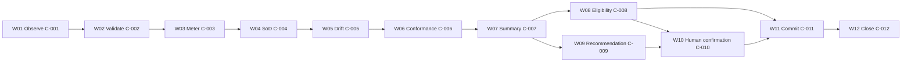

# Document Control

| Field | Value | Evidence |
|---|---|---|
| Methodology basis | Stage 6B purpose, inputs, checks, outputs, controls and gate | [SRC-01, Stage 6B section] |
| Scope | End-to-end consolidation and assurance of component designs for W01-W12 | [SRC-01, Purpose and Inputs] |
| Consolidation baseline | Stage 6 detailed design package | [SRC-02, complete Stage 6 file] |
| ABBA evidence baseline | Reuse catalogue rows | [SRC-03, selected rows] |
| Stage gate | Factory Design Authority (including SME) | [SRC-01, approval gate] |

# Purpose

This Stage 6B deliverable consolidates all Stage 6 component designs into a single end-to-end solution design package, confirms consistency across components, controls and handovers, validates unit test coverage completeness, captures unresolved issues, and prepares a readiness recommendation for Stage 7.

# Inputs

| Input ID | Input | Evidence |
|---|---|---|
| IN-6B-01 | Stage 6 detailed component designs | [SRC-02, component matrix] |
| IN-6B-02 | Workflow and controls baseline W01-W12 / C-001 to C-012 | [SRC-04, Stage 4 classified workflow] |
| IN-6B-03 | Stage 5B consolidated data model | [SRC-05, unified model and dictionary] |
| IN-6B-04 | ABBA reuse reference | [SRC-03, selected rows] |
| IN-6B-05 | Stage 6B instructions and quality requirements | [SRC-06, Stage 6B instruction and skill files] |

# Consolidation Approach and Checks Applied

| Check ID | Check objective | Result | Evidence |
|---|---|---|---|
| CHK-6B-01 | All component designs assembled in one package | Pass | [SRC-02, A-001 to A-012] |
| CHK-6B-02 | End-to-end workflow walk-through is complete | Pass | [SRC-02, W01-W12 sequence] |
| CHK-6B-03 | Every input and output is consistently mapped | Pass | [SRC-02, per-component IO and handovers] |
| CHK-6B-04 | Control points are complete and coherent | Pass | [SRC-04, C-001 to C-012 and SRC-02 control design] |
| CHK-6B-05 | Human intervention points are complete | Pass | [SRC-02, HIP-001 to HIP-005] |
| CHK-6B-06 | Unit tests cover all components and scenarios | Pass | [SRC-02, UT-001 to UT-024] |
| CHK-6B-07 | ABBA reuse variances are explicit | Pass | [SRC-02 ABBA section and SRC-03 rows] |
| CHK-6B-08 | Open issues are explicit and actioned | Pass with open actions | [Issue log in this document] |
| CHK-6B-09 | Build-readiness for Stage 7 is assessed | Pass with conditions | [Readiness assessment] |

# Consolidated End-to-End Design View

## Workflow and control spine

## Component interaction consolidation

| Layer | Components | Consolidated responsibility |
|---|---|---|
| Orchestration | A-012 | Sequence control, branch routing, escalation path control |
| Intake and task processing | A-001, A-002, A-010 | Input curation, deterministic costing, authorised write-back |
| Control assurance | A-003, A-005, A-007, A-011 | SoD, conformance, eligibility and closure integrity |
| Insight generation | A-004, A-006, A-008 | Drift signal insight, summary synthesis, treatment recommendation |
| Human decision experience | A-009 | Attributable decision capture and authority routing |

# Interface Consistency and Handover Assurance

| Handover | Consistency validation | Outcome |
|---|---|---|
| H-001 | Source references to W01 input package are complete | Pass |
| H-002 | Candidate package structure supports validation checks | Pass |
| H-003 | Validated package includes all deterministic metering fields | Pass |
| H-004 | Cost context keys align with SoD requirement | Pass |
| H-005 | Multi-signal payload supports summary aggregation | Pass |
| H-006 | Shared summary keys support parallel eligibility and recommendation | Pass |
| H-007 | Recommendation pack includes rationale and evidence references | Pass |
| H-008 | Eligibility or authorised decision routing remains unambiguous | Pass with caveat on policy-boundary codification |
| H-009 | Commit and trace links support closure validation | Pass |

# Consolidated Control-and-Evidence Coverage

| Control ID | Objective | Design quality | Consolidation judgement |
|---|---|---|---|
| C-001 | Intake completeness | Strong deterministic check | Pass |
| C-002 | Evidence sufficiency | Strong deterministic check | Pass |
| C-003 | Meter reproducibility | Strong deterministic check | Pass |
| C-004 | SoD compliance | Strong deterministic check | Pass |
| C-005 | Drift threshold governance | Deterministic with policy dependency | Pass with policy-threshold dependency |
| C-006 | Conformance coverage | Deterministic with denominator dependency | Pass with denominator-definition dependency |
| C-007 | Signal integrity | Strong aggregation check | Pass |
| C-008 | Policy boundary eligibility | Strong logic, boundary detail pending | Pass with boundary-clarification dependency |
| C-009 | Recommendation quality | Good rationale guardrail | Pass |
| C-010 | Human approval accountability | Strong attribution controls | Pass |
| C-011 | Write-back authorisation | Strong state-transition controls | Pass |
| C-012 | Closure and audit completeness | Strong closure checks | Pass |

# Unit Test Consolidation and Coverage Report

## Coverage summary

| Coverage domain | Result |
|---|---|
| Components with at least one normal test | 12/12 Pass |
| Components with at least one exception test | 12/12 Pass |
| Workflow step coverage by tests | W01-W12 covered Pass |
| Control coverage by tests | C-001 to C-012 covered Pass |
| Human intervention scenario coverage | HIP-001 to HIP-005 covered Pass |

## Consolidated test completeness view

| Component | Normal scenario present | Exception scenario present | Consolidation status |
|---|---|---|---|
| A-001 | Yes | Yes | Complete |
| A-002 | Yes | Yes | Complete |
| A-003 | Yes | Yes | Complete |
| A-004 | Yes | Yes | Complete |
| A-005 | Yes | Yes | Complete |
| A-006 | Yes | Yes | Complete |
| A-007 | Yes | Yes | Complete |
| A-008 | Yes | Yes | Complete |
| A-009 | Yes | Yes | Complete |
| A-010 | Yes | Yes | Complete |
| A-011 | Yes | Yes | Complete |
| A-012 | Yes | Yes | Complete |

# ABBA Reuse Consolidation Summary

| ABBA ID | Mapped design component(s) | Reuse posture | Consolidated finding |
|---|---|---|---|
| VA-1172 | A-001, A-003 | Adapted | Reuse is valid; governance-specific evidence checks added |
| VA-1304 | A-005 | Adapted | Reuse is valid; conformance ratio logic extended |
| VA-1301 | A-010 | Adapted | Reuse is valid; registry state model explicitly added |
| VA-1334 | A-012 | Adapted | Reuse is valid; full W01-W12 route logic required |
| VA-1338 | A-011 | Adapted | Reuse is valid; closure evidence completeness strengthened |

# Recommended Implementation Technology (Non-binding Stage 6B Guidance)

Stage 6 and Stage 6B remain technology-agnostic by design. The recommendation below is advisory for Stage 7 planning only.

| Design concern | Recommended technology class | Reason |
|---|---|---|
| Deterministic controls and rule checks | Rules engine or strongly-typed service layer | Improves reproducibility and auditability |
| Workflow orchestration across W01-W12 | Event-driven orchestration service | Supports branching, retries and exception routing |
| Human decision capture | Approval workflow module with identity integration | Supports attributable approvals |
| Audit and closure evidence persistence | Immutable event/audit store plus relational registry | Supports traceability and closure validation |
| Insight/recommendation rendering | LLM-assisted summarisation with strict grounding | Improves readability while retaining deterministic boundaries |

# RACI Consolidation and Accountability Check

| Activity group | Responsible | Accountable | Consolidation finding |
|---|---|---|---|
| Intake to conformance (W01-W06) | A-001 to A-005 | AI Governance Lead | Clear |
| Summary to recommendation (W07-W09) | A-006 to A-008 | AI Governance Lead | Clear |
| Human decision and commit (W10-W11) | A-009, A-010 | AI Governance Lead and Registry owner (TBC) | Partially open due owner-TBC |
| Closure and evidence (W12) | A-011 | Control owner and audit owner (TBC) | Partially open due owner-TBC |
| End-to-end sequencing | A-012 | AI Governance Lead | Clear |

# Unresolved Issues, Risks and Actions

| Issue ID | Type | Description | Impact | Owner | Due stage | Status |
|---|---|---|---|---|---|---|
| IS-6B-01 | Open question | Owner-role naming conflict remains unresolved | Accountability ambiguity | Governance design owner | Stage 7 planning | Open |
| IS-6B-02 | Open question | L2/L3 policy boundary codification incomplete | Eligibility boundary ambiguity | Policy owner | Stage 7 planning | Open |
| IS-6B-03 | Missing information | Trigger and cadence taxonomy not fully formalised | Inconsistent cycle start risk | Orchestration owner | Stage 7 planning | Open |
| IS-6B-04 | Missing information | Closure status and re-open taxonomy incomplete | W12 closure consistency risk | Control owner | Stage 7 planning | Open |
| IS-6B-05 | Dependency | Registry source-system owner not confirmed | Write-back accountability risk | Capability owner | Stage 7 planning | Open |
| IS-6B-06 | Risk | Informational foreign-key constraints need runtime assurance | Data integrity risk | Data governance owner | Stage 7 planning | Open |

# Readiness Assessment for Stage 7

| Readiness criterion | Status | Notes |
|---|---|---|
| Design completeness | Pass | Full component, control, handover and test design assembled |
| Design consistency | Pass | No logical conflicts detected across W01-W12 path |
| Test design completeness | Pass | Normal and exception scenarios for all components |
| Governance ownership clarity | Conditional | Owner-role and source-system ownership items still open |
| Policy-boundary clarity | Conditional | L2/L3 codification pending |
| Overall Stage 7 readiness | Pass with conditions | Proceed if open issues are tracked in implementation backlog |

# Design Authority Decision Record

| Decision ID | Authority | Decision | Conditions | Date |
|---|---|---|---|---|
| DA-6B-001 | Factory Design Authority (including SME) | Pending | Accept Stage 6B package subject to issue log IS-6B-01 to IS-6B-06 action plan | TBC - source required |

# Exit Criteria Validation

| Stage 6B exit item | Status | Evidence |
|---|---|---|
| Consolidated design package created | Pass | This Stage 6B deliverable |
| End-to-end design validated | Pass | CHK-6B-02 and workflow/control spine |
| Control and handover consistency validated | Pass | CHK-6B-03/04 and handover table |
| Unit test coverage completeness validated | Pass | CHK-6B-06 and coverage report |
| Open issues and risks documented | Pass | Issue log IS-6B-01 to IS-6B-06 |
| Stage 7 readiness recommendation produced | Pass with conditions | Readiness assessment section |

# Conclusion

The Stage 6 design package is consolidated and coherent for AgentOps Control Tower. The end-to-end design, controls, handovers and unit tests meet Stage 6B requirements. Progression to Stage 7 is recommended with conditions: ownership, policy-boundary codification, trigger/cadence taxonomy and closure taxonomy must be tracked as mandatory implementation backlog items.

# Evidence Index

| Source ID | Source |
|---|---|
| SRC-01 | Delivery-Control/Stage_6.md |
| SRC-02 | Stage 6 Output/HR-GOV-001_AgentOps_Control_Tower_Stage_6_Detailed_Design_v0.1.md |
| SRC-03 | ABBA-Reuse-Agents/Annotated_Agents_H2RList.csv |
| SRC-04 | Stage 4 Output/Agent_Ops_Control_Tower_Stage_4_Classify.md |
| SRC-05 | Stage 5B Outpit/HR-GOV-001_AgentOps_Control_Tower_Stage5B_Data_Model_Consolidation_v0.1.md |
| SRC-06 | Source Documents/stage-6b-document-generation.instructions.md; Source Documents/stage-6b-SKILL.md |

KPMG confidential
